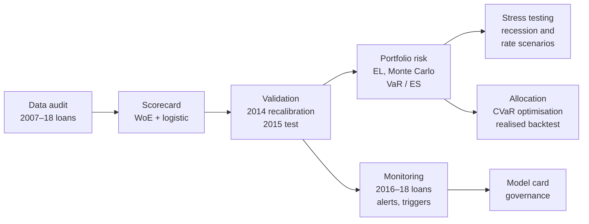
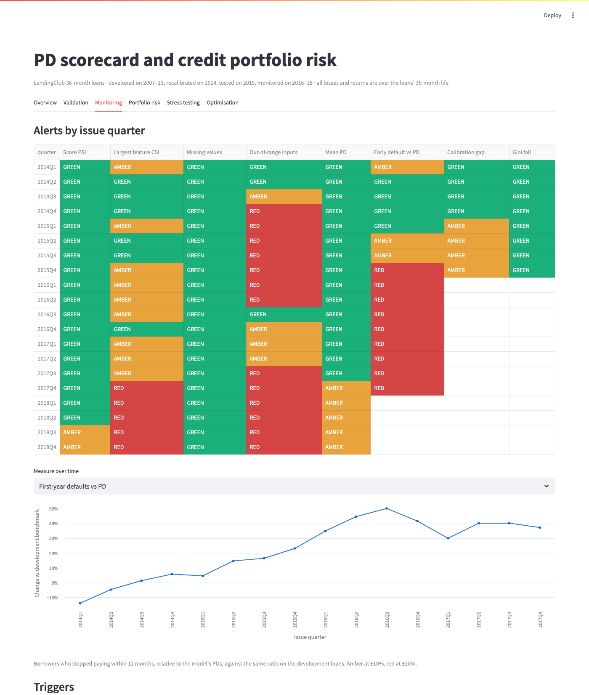

# Credit Risk PD Scorecard — LendingClub

[](https://github.com/NishaanthSivakumar/credit-risk-pd-scorecard/actions/workflows/ci.yml)

A probability-of-default (PD) model for unsecured consumer loans, taken through the full life of a
bank credit model: development, validation, recalibration, portfolio loss modelling, stress testing,
portfolio allocation and ongoing monitoring. Built on 1.6 million LendingClub loans, with every
result tested on loans the model never saw.

**Live dashboard:** [credit-risk-pd-scorecard.streamlit.app](https://credit-risk-pd-scorecard.streamlit.app)

**Read:** [validation report](reports/validation_report.md) ·
[portfolio risk report](reports/portfolio_risk_report.md) ·
[monitoring report](reports/monitoring_report.md) · [model card](MODEL_CARD.md) ·
[data audit](reports/data_audit.md) · [notebooks](notebooks/)

## 1. Project overview



| Stage | What it shows |
|---|---|
| Scorecard | WoE binning and Information Value written from scratch; a 9-feature logistic regression scaled to points |
| Validation | Out-of-time testing, recalibration, block-bootstrap confidence intervals, a challenger, sensitivity analysis and decision rules fixed in code |
| Portfolio risk | Loss given default and exposure measured from real recoveries; a one-factor Gaussian Monte Carlo engine for lifetime VaR and Expected Shortfall |
| Stress testing | Scenarios through the Vasicek conditional PD, anchored to LendingClub's own recession-era loans, plus a reverse stress test |
| Allocation | Expected-return, expected-loss and CVaR strategies solved as linear programmes, scored on what the loans actually returned |
| Monitoring | Quarterly stability, data-quality, early-default and performance monitoring with recalibration and redevelopment triggers |

## 2. Business problem

A lender needs to know, at application, how likely a borrower is to default, and an investor or risk
team needs to know what that means for the losses on a whole book of loans, in normal times and in a
recession. The model's job is to rank applicants and to estimate each loan's lifetime PD. The harder
question, and the focus of this project, is whether those estimates still hold on later loans, and
what happens to losses, allocation decisions and monitoring when they don't.

## 3. Dataset

[Lending Club Loan Data](https://www.kaggle.com/datasets/wordsforthewise/lending-club) (Kaggle,
*wordsforthewise*): 2.26 million accepted loans, 2007 to 2018Q4, snapshot March 2019.

| Sample | Vintages | Loans | Default rate | Use |
|---|---|---|---|---|
| Train / test | 2007–13 (random 70/30) | 175,426 | 12.6% | Development |
| Calibration | 2014 | 162,570 | 13.7% | Recalibration only |
| Out-of-time | 2015 | 283,026 | 14.9% | Final test, portfolio, allocation |
| Production | 2016–18 | 988,585 | not yet known | Monitoring |

Only 36-month loans issued up to 2015 are modelled, so every loan had time to reach its final
outcome; 0.02% were still open and are excluded. Fields recorded after origination (payments,
recoveries) never enter the model; they are used only to measure losses. All checks:
[data audit](reports/data_audit.md).

## 4. Model methodology

1. Bin 18 candidate features on the training data (monotonic bad rates, at least 5% of loans per bin,
   a separate bin for missing values) and replace each bin by its Weight of Evidence.
2. Keep features with IV ≥ 0.02, at most 10% missing and correlation below 0.7 with a stronger feature.
3. Fit a logistic regression and drop features until every coefficient is significant and negative.
4. Scale to points: 600 at 30:1 odds, 20 points to double the odds. Seven rating grades.
5. Recalibrate the intercept on 2014 loans; bins, coefficients and points are unchanged.

Final inputs: FICO, income, loan-to-income, recent credit inquiries, loan purpose, debt-to-income,
revolving utilisation, home ownership and length of credit history. LendingClub's own grade and
interest rate are kept out of the model and used as a benchmark. Details: [model card](MODEL_CARD.md).

## 5. Validation methodology

The model is assessed on ten dimensions (conceptual soundness, data, target, discrimination,
calibration, stability, out-of-time performance, challenger, sensitivity, limitations), each RAG-rated
against thresholds in `config.py`. A fixed rule set then maps the ratings to approve, conditionally
approve, recalibrate, redevelop or reject. The rules are in `src/pdmodel/assessment.py`, written before
the assessment was run.

- **Chronological:** develop on 2007–13, choose and fit the recalibration on 2014, test once on 2015.
- **Uncertainty:** bootstrap intervals that resample whole issue months, because loans issued in the
  same month share the same economy.
- **Challenger:** gradient boosting on the same data, compared on the same resamples.
- **Sensitivity:** borrower characteristics, missing inputs, coefficient uncertainty, sub-populations,
  approval cut-offs and seven alternative developments.

## 6. Key model performance results

| Sample | Gini | KS | Score PSI vs train |
|---|---|---|---|
| Train (2007–13) | 0.316 | 0.227 | – |
| Test (2007–13) | 0.305 | 0.221 | 0.000 |
| Calibration (2014) | 0.293 | 0.213 | 0.007 |
| **Out-of-time (2015)** | **0.296** (95% CI 0.292–0.300) | **0.213** | **0.001** |

The ranking holds on loans the model never saw: Gini is only 6% below train, and default rates fall
steadily from 27.2% in the riskiest score decile to 4.3% in the safest. A gradient-boosting challenger
does better by just 0.022 Gini, below the 0.03 that would justify a less interpretable model.
LendingClub's own sub-grade reaches 0.357, using more data than these application fields.


## 7. Calibration and monitoring findings

**The PD level drifts, and a one-year-old recalibration cannot keep up.** On 2015 loans the model as
developed predicts 12.54% against 14.89% observed. Re-fitting the intercept on 2014 loans raises the
prediction to 13.18%, closing only a quarter of the gap; 6 of 7 grades still fail the binomial test.
Borrowers looked *safer* on paper while defaulting more. Validation decision: **Recalibrate**.

The validation also found that leaving income or credit inquiries blank *lowers* a borrower's PD by
13–19%, because those fields were almost never missing in training.

**Monitoring the 2016–18 loans** confirms the drift long before those loans mature: the score
distribution stays stable, but borrowers stopped paying within their first year 30–50% more often
than the PDs imply. Monitoring triggers recalibration by late 2016 and redevelopment by late 2017.



## 8. Portfolio risk methodology

Expected loss per loan = PD × LGD × EAD, over the loan's 36-month life. LGD (89%) and EAD (58% of the
amount funded) are measured on 2007–14 charge-offs, by rating grade. Loss distributions come from a
one-factor Gaussian (Vasicek) Monte Carlo model with the Basel retail asset correlation per loan;
20,000 scenarios reproduce the analytical expected loss and large-portfolio VaR to within 0.15%.

On the 2015 book ($3.62bn funded), expected lifetime loss is **6.35%** against **7.56%** realised. The
gap is the PD shortfall: 13% more defaults than predicted, while the loss per default was within 2%.
The 99% lifetime VaR is 13.45% and the 99% Expected Shortfall 15.0%. The correlation assumption is the
biggest driver of the tail, moving the 99% VaR from 10% to 21%.
[Portfolio risk report](reports/portfolio_risk_report.md).

## 9. Stress-testing results

| Scenario | Economy | Expected lifetime loss | vs base |
|---|---|---|---|
| Base | average | 6.35% | ×1.00 |
| Interest rate shock (+300bp) | 1 in 5 | 8.26% | ×1.30 |
| Mild recession | 1 in 10 | 10.32% | ×1.62 |
| Severe recession | 1 in 50 | 15.29% | ×2.41 |

The mild scenario matches what LendingClub's 2007 loans went through (a 1-in-10 economy implied by
their default rate); the severe one goes beyond anything in the data and exceeds the base 99% VaR.
A rate rise barely reaches these fixed-rate borrowers' payments, so its risk runs through the economy.
In relative terms the safest loans are hit hardest: grade 1 losses rise 3.8 times in a severe
recession, against 1.9 times for grade 7.


## 10. Portfolio optimisation results

Allocating the 2015 book across 32 segments (our rating grade × LendingClub grade), using only what is
known when the loans are issued:

| Strategy | Expected | Realised |
|---|---|---|
| Whole book (benchmark) | 6.86% | 5.30% |
| **Minimise expected loss** | 9.10% | **6.31%** |
| Maximise expected return | 14.91% | 3.74% |
| Best possible with hindsight | – | 6.34% |

Minimising expected loss beat the whole book by a point and came within 0.03 points of the hindsight
optimum. Every strategy that reached for expected return did worse than the book: the optimiser put
its money into high-rate loans, exactly where the PD, prepayment and recovery inputs were most wrong.
Neither a PD that uses LendingClub's grade nor each segment's own history fixes this.

## 11. Model limitations

In full in the [limitations register](reports/limitations_register.md):

- **Reject inference:** only approved loans are observed.
- **Lifetime PD:** not a 12-month PD, so not directly usable for Basel IRB or IFRS 9 stage 1.
- **No macroeconomic drivers:** PDs do not move with the economy, and a lagged recalibration trails a
  rising default rate.
- **Modest discrimination** from application data alone (Gini 0.296).
- **Rare missing values** and **inputs outside the training range** are handled poorly.
- **One-factor dependence:** no sector factors, and LGD does not move with the economy in the base case.
- **Self-validation:** the validator also built the model.

## 12. Repository structure

```
├── MODEL_CARD.md            model card and governance checklist
├── IMPLEMENTATION.md        improvement roadmap and progress tracker
├── notebooks/               01–10: every step, with every result displayed
│   ├── 01–04                data and target, WoE binning, scorecard, validation
│   ├── 05–06                recalibration and uncertainty, sensitivity and decision
│   ├── 07–09                portfolio risk, stress testing, portfolio optimisation
│   └── 10                   monitoring
├── src/pdmodel/             the calculations, shared by the notebooks, pipeline and tests
│   ├── data, audit          loading, target, features, splits; data audit
│   ├── woe, model           WoE binning and IV; selection, logistic regression, scorecard, challenger
│   ├── validation, calibration, bootstrap, sensitivity, assessment
│   ├── portfolio, simulation, stress, optimisation
│   ├── monitoring           quarterly monitoring, alerts and triggers
│   └── config, plots, reports, pipeline
├── scripts/                 run_pipeline.py; make_synthetic_data.py (smoke tests only)
├── dashboard/               Streamlit app reading the precomputed result tables
├── tests/                   unit tests for every module, run in CI
└── reports/                 reports, commentary, limitations register, tables, figures
```

## 13. Installation

Python 3.13.

```bash
git clone https://github.com/NishaanthSivakumar/credit-risk-pd-scorecard.git
cd credit-risk-pd-scorecard
python -m venv .venv && source .venv/bin/activate
pip install -r requirements.txt
```

Data: download the Kaggle dataset (link in section 3) and leave `accepted_2007_to_2018Q4.csv.gz`
anywhere under `data/raw/`; the code finds it. Only 30 of its 151 columns are loaded, which needs a few
GB of RAM. `data/` is git-ignored.

**Dashboard:** live at [credit-risk-pd-scorecard.streamlit.app](https://credit-risk-pd-scorecard.streamlit.app),
or run it locally (no data download needed; it reads the committed result tables):

```bash
pip install -r dashboard/requirements.txt
streamlit run dashboard/app.py
```

The hosted copy runs on [Streamlit Community Cloud](https://streamlit.io/cloud) from `dashboard/app.py`
and redeploys on every push to `main`.

## 14. Reproduction

```bash
python scripts/run_pipeline.py           # everything: tables, figures and all reports, about 15 minutes
python scripts/run_pipeline.py --quick   # fewer bootstrap draws and scenarios, for a fast check
python -m pytest -q                      # unit tests
```

- **Deterministic:** every random step (sample split, bootstrap, Monte Carlo, optimisation scenarios)
  uses a fixed seed from `config.py`, so a re-run reproduces every number.
- **Pinned environment:** `requirements.txt` lists the exact package versions used. A full re-run in
  a clean environment built from it, on a different maths library (Apple Accelerate instead of
  OpenBLAS), agrees to within 0.001% on every figure except one Monte Carlo diagnostic (the simulation
  error measured in standard errors: 0.516 vs 0.515). On Apple-silicon Macs, NumPy installed with pip
  may print harmless "overflow encountered in matmul" warnings.
- **Data version:** `accepted_2007_to_2018Q4.csv.gz`, 392,582,231 bytes, SHA-256
  `55c16f75120f897683f02e7aabcf080d0e4a20c4832feb1d592cfa941bd62a2d`.
- **Notebooks:** run 01 → 10 in order; each saves what the next needs to `data/processed/`.
- **Reports:** numbers come from the run; the interpretation is in `reports/*commentary.md`, so
  re-running never overwrites it.
- **Without the data:** `python scripts/make_synthetic_data.py` writes a fake LendingClub-shaped file
  for testing the code (`--data data/raw/synthetic/accepted_2007_to_2018Q4_SYNTHETIC.csv.gz`); its
  results are meaningless. CI runs the whole pipeline on it on every push.

## 15. Future improvements

- **Redevelop the PD model**, as monitoring recommends: add LendingClub's grade or interest rate, a
  time-varying or macro-linked intercept, capped WoE for rare missing values, and bins that cover the
  current debt-to-income range.
- **Reject inference** using LendingClub's rejected-applications file.
- **Twelve-month PDs** from payment histories, for IFRS 9 and Basel comparisons.
- **A two-factor portfolio model** with a sector factor for loan purpose, and downturn LGD linked to
  the economy.
- **A real-time allocation backtest** that uses only outcomes known at each investment date.
- **An independent validation** of the redeveloped model.
