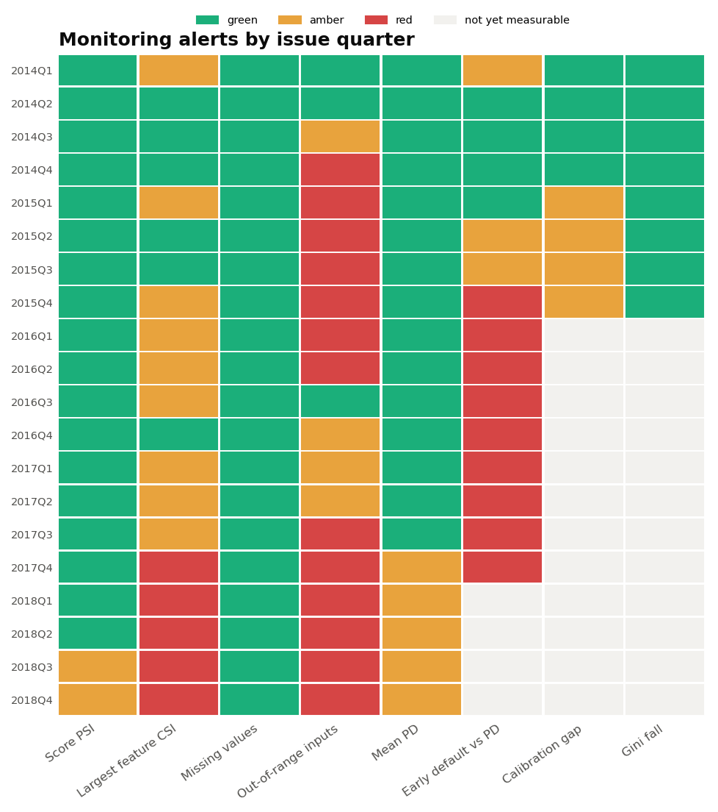
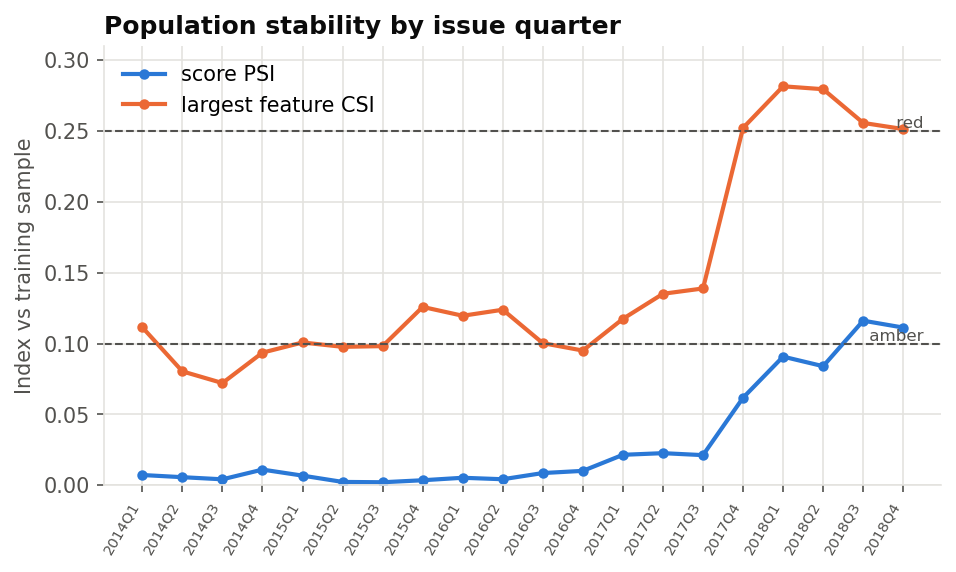
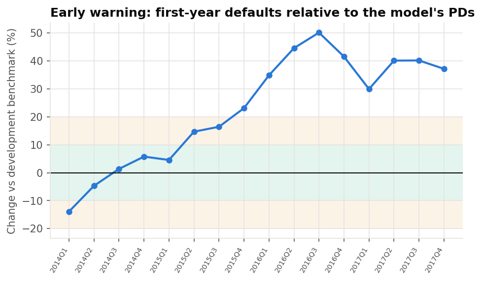
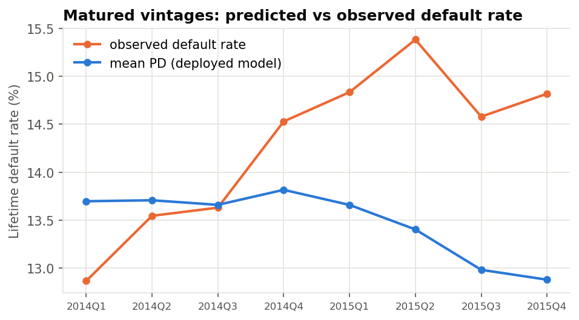

# Model Monitoring Report

*Generated by `scripts/run_pipeline.py`. Commentary: `reports/monitoring_commentary.md`. Thresholds:
`config.py` (`MON_*`).*

## 1. Scope

| Item | Value |
|---|---|
| Monitored model | PD scorecard (9 features) with the intercept recalibrated on 2014 loans, as validated |
| Reference population | Training sample (2007–2013) for stability; all development loans (2007–2013) for the early-default benchmark |
| Production stream | 36-month loans issued 2016–2018: 988,585 loans, last issued Dec 2018 |
| Matured vintages | 2014–2015 (full 36-month outcome known) |
| Monitoring date | Data snapshot, March 2019 |

Status of the production loans at the snapshot:

| loan_status | share |
|---|---|
| Current | 57.3% |
| Fully Paid | 32.9% |
| Charged Off | 7.8% |
| Late (31-120 days) | 1.3% |
| In Grace Period | 0.5% |
| Late (16-30 days) | 0.3% |
| Default | 0.0% |

What can be measured, and when:

| Question | Measure | Available |
|---|---|---|
| Has the population moved? | Score PSI, feature CSI, missing values, out-of-range inputs, mean PD, grade mix | At origination |
| Are borrowers defaulting faster than predicted? | First-year default rate ÷ mean PD, against the development ratio (0.346) | After 15 months |
| Does the model still rank and calibrate? | Gini, KS, calibration gap, binomial test by grade | After 36 months |

## 2. Alert summary

| action | rule | fired |
|---|---|---|
| Recalibrate | Calibration gap AMBER or RED in the latest matured year | **FIRED** |
| Recalibrate | Any grade failing the binomial test at 1% in the latest matured year | **FIRED** |
| Recalibrate | Early default vs PD AMBER or RED for two quarters in a row | **FIRED** |
| Redevelop | Score PSI or largest feature CSI RED in any quarter | **FIRED** |
| Redevelop | Gini fall RED in any matured quarter | not fired |
| Redevelop | Early default vs PD RED for four quarters in a row (recalibration not keeping up) | **FIRED** |

**Monitoring calls for recalibration from late 2016 and for redevelopment from late 2017.** Both calls
come well before the affected loans mature.

- *The score distribution is stable* (PSI below 0.10 until 2018Q3), so a check on the score alone would
  have missed the problem.
- *First-year defaults outran the PDs:* against the development benchmark, borrowers stopped paying
  within a year 23% more often than the PDs imply on 2015Q4 loans, and 30–50% more often on every
  quarter of 2016–17 loans.
- *Inputs left the training range:* debt-to-income exceeded the training maximum for up to 6.6% of
  loans in a quarter, and revolving utilisation shifted enough to turn RED from 2017Q4.
- *Borrowers looked safer while defaulting more:* the mean PD fell 15% by 2018, the same pattern the
  validation found on 2015 loans.

All three recalibration triggers and two of the three redevelopment triggers fired. Ranking power is
the one thing that held: Gini on matured quarters stayed within 6% of its validated level.

## 3. Population stability

| quarter | loans | score_psi | max_csi | max_csi_feature |
|---|---|---|---|---|
| 2014Q1 | 34,074 | 0.007 | 0.111 | purpose |
| 2014Q2 | 37,881 | 0.006 | 0.080 | purpose |
| 2014Q3 | 40,595 | 0.004 | 0.072 | purpose |
| 2014Q4 | 50,020 | 0.011 | 0.094 | fico |
| 2015Q1 | 56,568 | 0.007 | 0.101 | purpose |
| 2015Q2 | 64,222 | 0.002 | 0.098 | purpose |
| 2015Q3 | 73,567 | 0.002 | 0.098 | purpose |
| 2015Q4 | 88,669 | 0.004 | 0.126 | purpose |
| 2016Q1 | 96,120 | 0.005 | 0.120 | dti |
| 2016Q2 | 74,537 | 0.004 | 0.124 | purpose |
| 2016Q3 | 73,898 | 0.009 | 0.100 | purpose |
| 2016Q4 | 78,940 | 0.010 | 0.095 | purpose |
| 2017Q1 | 72,410 | 0.022 | 0.117 | inq_last_6mths |
| 2017Q2 | 77,105 | 0.023 | 0.135 | purpose |
| 2017Q3 | 88,227 | 0.021 | 0.139 | revol_util |
| 2017Q4 | 82,677 | 0.062 | 0.252 | revol_util |
| 2018Q1 | 75,412 | 0.091 | 0.282 | revol_util |
| 2018Q2 | 91,506 | 0.084 | 0.279 | revol_util |
| 2018Q3 | 89,574 | 0.116 | 0.256 | revol_util |
| 2018Q4 | 88,179 | 0.111 | 0.251 | revol_util |

CSI by feature (against the training sample):

| quarter | purpose | fico | credit_hist_years | revol_util | dti | home_ownership | annual_inc | loan_to_income | inq_last_6mths |
|---|---|---|---|---|---|---|---|---|---|
| 2014Q1 | 0.111 | 0.075 | 0.070 | 0.028 | 0.020 | 0.018 | 0.013 | 0.011 | 0.002 |
| 2014Q2 | 0.080 | 0.060 | 0.044 | 0.032 | 0.014 | 0.011 | 0.005 | 0.002 | 0.002 |
| 2014Q3 | 0.072 | 0.050 | 0.040 | 0.026 | 0.041 | 0.008 | 0.008 | 0.003 | 0.003 |
| 2014Q4 | 0.093 | 0.094 | 0.049 | 0.022 | 0.071 | 0.017 | 0.004 | 0.005 | 0.057 |
| 2015Q1 | 0.101 | 0.080 | 0.056 | 0.019 | 0.090 | 0.017 | 0.006 | 0.008 | 0.060 |
| 2015Q2 | 0.098 | 0.062 | 0.042 | 0.030 | 0.083 | 0.017 | 0.006 | 0.005 | 0.065 |
| 2015Q3 | 0.098 | 0.042 | 0.061 | 0.041 | 0.084 | 0.019 | 0.012 | 0.005 | 0.076 |
| 2015Q4 | 0.126 | 0.040 | 0.067 | 0.052 | 0.087 | 0.019 | 0.020 | 0.005 | 0.064 |
| 2016Q1 | 0.116 | 0.029 | 0.069 | 0.057 | 0.120 | 0.030 | 0.034 | 0.006 | 0.066 |
| 2016Q2 | 0.124 | 0.027 | 0.039 | 0.084 | 0.096 | 0.033 | 0.015 | 0.006 | 0.092 |
| 2016Q3 | 0.100 | 0.052 | 0.022 | 0.083 | 0.046 | 0.026 | 0.017 | 0.023 | 0.070 |
| 2016Q4 | 0.095 | 0.036 | 0.047 | 0.079 | 0.087 | 0.017 | 0.025 | 0.039 | 0.080 |
| 2017Q1 | 0.115 | 0.023 | 0.054 | 0.091 | 0.074 | 0.020 | 0.038 | 0.023 | 0.117 |
| 2017Q2 | 0.135 | 0.024 | 0.029 | 0.118 | 0.077 | 0.019 | 0.026 | 0.045 | 0.110 |
| 2017Q3 | 0.134 | 0.026 | 0.023 | 0.139 | 0.086 | 0.019 | 0.014 | 0.047 | 0.116 |
| 2017Q4 | 0.146 | 0.036 | 0.032 | 0.252 | 0.094 | 0.033 | 0.022 | 0.051 | 0.117 |
| 2018Q1 | 0.099 | 0.060 | 0.036 | 0.282 | 0.102 | 0.032 | 0.026 | 0.053 | 0.157 |
| 2018Q2 | 0.161 | 0.039 | 0.020 | 0.279 | 0.091 | 0.029 | 0.021 | 0.049 | 0.176 |
| 2018Q3 | 0.138 | 0.030 | 0.021 | 0.256 | 0.100 | 0.018 | 0.035 | 0.041 | 0.214 |
| 2018Q4 | 0.132 | 0.024 | 0.022 | 0.251 | 0.110 | 0.014 | 0.041 | 0.048 | 0.173 |

The score PSI stays below 0.025 until 2017Q3, then rises to 0.06–0.12 in 2017Q4–2018, reaching AMBER
in the last two quarters. The feature view is more telling. `purpose` drifts in and out of AMBER
(CSI 0.10–0.14) throughout. `revol_util` jumps to RED from 2017Q4 (0.25–0.28): the share of borrowers
using less than 21% of their revolving credit doubled, from 10% in training to 21%. Lower utilisation
earns more points, so this shift alone pushes PDs down.

## 4. Input data quality

Largest rise in a model input's missing share (against training), and largest share of values outside
the range seen in training:

| quarter | max_missing_change | max_missing_feature | max_out_of_range | max_out_of_range_feature |
|---|---|---|---|---|
| 2014Q1 | +0.00% | fico | 0.01% | revol_util |
| 2014Q2 | +0.00% | fico | 0.01% | revol_util |
| 2014Q3 | +0.00% | fico | 1.46% | dti |
| 2014Q4 | +0.00% | fico | 3.32% | dti |
| 2015Q1 | +0.00% | fico | 3.53% | dti |
| 2015Q2 | +0.00% | fico | 3.46% | dti |
| 2015Q3 | +0.00% | fico | 3.32% | dti |
| 2015Q4 | +0.00% | dti | 3.48% | dti |
| 2016Q1 | +0.01% | dti | 5.13% | dti |
| 2016Q2 | +0.02% | dti | 4.82% | dti |
| 2016Q3 | +0.00% | dti | 0.09% | dti |
| 2016Q4 | +0.02% | dti | 0.60% | dti |
| 2017Q1 | +0.02% | dti | 0.78% | dti |
| 2017Q2 | +0.07% | dti | 1.39% | dti |
| 2017Q3 | +0.12% | dti | 3.10% | dti |
| 2017Q4 | +0.17% | dti | 5.94% | dti |
| 2018Q1 | +0.19% | dti | 6.19% | dti |
| 2018Q2 | +0.20% | dti | 5.87% | dti |
| 2018Q3 | +0.21% | dti | 6.15% | dti |
| 2018Q4 | +0.15% | dti | 6.62% | dti |

Missing values are not a concern: no model input's missing share rose by more than 0.21 points.
Inputs outside the training range are. Debt-to-income was capped at 35 in the training data;
LendingClub accepted higher ratios from late 2014, and 3–5% of loans in 2014Q4–2016Q2 and 6–7% in 2018
have a ratio the model never saw; the share fell back to 0.1–1.4% in 2016Q3–2017Q2 before rising again.
The scorecard puts all of these loans in its top debt-to-income bin, which assumes the risk stops rising
at the training edge.

## 5. Prediction drift

Mean PD of the deployed model (change against its validated level of 13.18% on
2015 loans) and the share of loans in each rating grade:

| quarter | loans | mean_pd | mean_pd_shift | grade_1 | grade_2 | grade_3 | grade_4 | grade_5 | grade_6 | grade_7 |
|---|---|---|---|---|---|---|---|---|---|---|
| 2014Q1 | 34,074 | 13.70% | +3.9% | 11.6% | 13.9% | 14.1% | 14.8% | 15.0% | 15.2% | 15.4% |
| 2014Q2 | 37,881 | 13.71% | +4.0% | 12.5% | 13.3% | 14.4% | 14.2% | 14.8% | 15.0% | 15.8% |
| 2014Q3 | 40,595 | 13.66% | +3.6% | 12.6% | 13.5% | 14.1% | 14.4% | 14.8% | 14.9% | 15.5% |
| 2014Q4 | 50,020 | 13.82% | +4.8% | 11.4% | 13.2% | 14.4% | 14.4% | 15.3% | 15.6% | 15.8% |
| 2015Q1 | 56,568 | 13.66% | +3.6% | 11.8% | 13.7% | 14.5% | 14.6% | 15.1% | 15.0% | 15.4% |
| 2015Q2 | 64,222 | 13.40% | +1.7% | 12.7% | 14.2% | 14.6% | 14.8% | 14.6% | 14.6% | 14.4% |
| 2015Q3 | 73,567 | 12.98% | -1.5% | 14.4% | 15.0% | 15.1% | 14.3% | 14.2% | 14.0% | 13.0% |
| 2015Q4 | 88,669 | 12.88% | -2.3% | 14.9% | 15.1% | 15.0% | 14.5% | 14.2% | 13.5% | 12.7% |
| 2016Q1 | 96,120 | 12.79% | -3.0% | 15.3% | 15.2% | 15.0% | 14.5% | 14.2% | 13.3% | 12.4% |
| 2016Q2 | 74,537 | 12.85% | -2.5% | 14.6% | 15.0% | 15.0% | 14.9% | 14.3% | 13.8% | 12.4% |
| 2016Q3 | 73,898 | 12.95% | -1.7% | 13.0% | 14.8% | 15.6% | 15.4% | 14.9% | 14.4% | 11.9% |
| 2016Q4 | 78,940 | 12.72% | -3.5% | 14.3% | 15.2% | 15.5% | 15.3% | 14.7% | 13.4% | 11.5% |
| 2017Q1 | 72,410 | 12.32% | -6.5% | 16.6% | 15.4% | 15.7% | 14.9% | 14.2% | 12.7% | 10.5% |
| 2017Q2 | 77,105 | 12.29% | -6.8% | 17.0% | 15.7% | 15.2% | 14.9% | 14.2% | 12.6% | 10.3% |
| 2017Q3 | 88,227 | 12.33% | -6.5% | 17.1% | 15.8% | 15.2% | 14.5% | 14.0% | 12.8% | 10.7% |
| 2017Q4 | 82,677 | 11.69% | -11.3% | 20.1% | 17.3% | 15.6% | 14.2% | 12.6% | 11.1% | 9.1% |
| 2018Q1 | 75,412 | 11.38% | -13.6% | 21.7% | 18.0% | 15.8% | 13.4% | 12.2% | 10.6% | 8.2% |
| 2018Q2 | 91,506 | 11.44% | -13.2% | 21.2% | 18.0% | 15.6% | 14.0% | 12.3% | 10.5% | 8.5% |
| 2018Q3 | 89,574 | 11.16% | -15.4% | 21.4% | 18.9% | 16.3% | 14.0% | 12.3% | 10.1% | 7.1% |
| 2018Q4 | 88,179 | 11.22% | -14.9% | 20.3% | 19.1% | 16.6% | 14.5% | 12.5% | 10.0% | 7.0% |

The mean PD of the deployed model fell steadily, from 13.7% on 2014 loans to 11.2–11.4% in 2018 (−13% to
−15% against the validated 2015 level; AMBER from 2017Q4). The grade mix shows why: the share of loans
in grade 1 rose from 15% at the end of 2015 to 20–22% in 2018, and the share in grade 7 fell from 13% to
7%. On the application data, LendingClub's borrowers were getting safer.

## 6. Early performance

First-year defaults (stopped paying within 12 months) against the model's
lifetime PDs. On the development loans (2007–2013), 34.6% of the mean
PD showed up as a first-year default; `ratio_shift` compares each quarter with that.

| quarter | loans | early_dr | mean_pd | ratio | gini_early | ratio_shift |
|---|---|---|---|---|---|---|
| 2014Q1 | 34,074 | 4.08% | 13.70% | 0.298 | 0.292 | -13.9% |
| 2014Q2 | 37,881 | 4.52% | 13.71% | 0.330 | 0.305 | -4.7% |
| 2014Q3 | 40,595 | 4.79% | 13.66% | 0.350 | 0.305 | +1.4% |
| 2014Q4 | 50,020 | 5.05% | 13.82% | 0.366 | 0.313 | +5.8% |
| 2015Q1 | 56,568 | 4.94% | 13.66% | 0.361 | 0.298 | +4.6% |
| 2015Q2 | 64,222 | 5.31% | 13.40% | 0.397 | 0.302 | +14.7% |
| 2015Q3 | 73,567 | 5.23% | 12.98% | 0.403 | 0.320 | +16.5% |
| 2015Q4 | 88,669 | 5.48% | 12.88% | 0.426 | 0.299 | +23.1% |
| 2016Q1 | 96,120 | 5.96% | 12.79% | 0.466 | 0.298 | +34.9% |
| 2016Q2 | 74,537 | 6.43% | 12.85% | 0.500 | 0.271 | +44.6% |
| 2016Q3 | 73,898 | 6.73% | 12.95% | 0.519 | 0.249 | +50.2% |
| 2016Q4 | 78,940 | 6.23% | 12.72% | 0.489 | 0.249 | +41.6% |
| 2017Q1 | 72,410 | 5.54% | 12.32% | 0.449 | 0.299 | +30.0% |
| 2017Q2 | 77,105 | 5.95% | 12.29% | 0.484 | 0.295 | +40.1% |
| 2017Q3 | 88,227 | 5.97% | 12.33% | 0.485 | 0.281 | +40.2% |
| 2017Q4 | 82,677 | 5.55% | 11.69% | 0.474 | 0.274 | +37.2% |

By borrower segment, 2016–2017 loans observed for at least
15 months:

| segment | loans | early_dr | mean_pd | ratio | ratio_shift | gini_early |
|---|---|---|---|---|---|---|
| All loans | 643,914 | 6.04% | 12.49% | 0.483 | +39.8% | 0.278 |
| FICO below 680 | 218,607 | 7.94% | 16.42% | 0.484 | +39.9% | 0.189 |
| FICO 740 and above | 78,641 | 2.90% | 5.63% | 0.514 | +48.7% | 0.342 |
| Debt-to-income above 25 | 150,404 | 8.09% | 15.19% | 0.533 | +54.1% | 0.223 |
| Income below $40k | 112,892 | 7.53% | 17.80% | 0.423 | +22.3% | 0.199 |
| Income $100k and above | 135,641 | 4.82% | 8.36% | 0.577 | +66.9% | 0.330 |
| Renters | 269,017 | 7.08% | 14.41% | 0.491 | +42.2% | 0.243 |
| Mortgage holders | 293,643 | 4.98% | 10.59% | 0.470 | +35.9% | 0.299 |
| Debt consolidation | 346,796 | 6.35% | 13.34% | 0.476 | +37.7% | 0.270 |
| Credit card refinancing | 137,175 | 4.79% | 10.28% | 0.466 | +34.8% | 0.302 |
| Small business | 7,503 | 9.73% | 20.75% | 0.469 | +35.6% | 0.244 |
| Loan $25k and above | 75,185 | 7.03% | 10.66% | 0.659 | +90.7% | 0.309 |

They were not. On the development loans, 34.6% of the mean PD showed up as a default in the first
year. That ratio was close to the benchmark for most of 2014 (2014Q1 was AMBER, but below it), AMBER for
2015Q2–Q3, and RED from 2015Q4 onward:
+23% for 2015Q4, +35% to +50% across 2016, and +30% to +40% across 2017. The validation found the same
direction on matured 2015 loans: mean PD down, default rate up.

The ratio mixes level and timing: it rises if more loans default, or if the same number default sooner.
The matured 2015 quarters, where both are visible, show the level effect is real: version 1.1
under-predicts every 2015 quarter by 1.2–2.0 points. The 2016–17 ratios run higher still, which suggests
the gap kept widening.

By segment, the shift is largest for loans of $25k and above (+91%) and high earners (+67% for incomes
of $100k and above), the same groups whose PDs the validation found most understated. Ranking on
first-year defaults holds up: Gini 0.25–0.30 across 2016–17.

## 7. Performance on matured vintages

| quarter | loans | observed_dr | mean_pd | cal_gap | eo_ratio | gini | ks | gini_drop | cal_intercept | cal_slope | grades_failing |
|---|---|---|---|---|---|---|---|---|---|---|---|
| 2014Q1 | 34,074 | 12.87% | 13.70% | +0.83% | 1.065 | 0.280 | 0.211 | +5.3% | -0.075 | 0.899 | 0 |
| 2014Q2 | 37,881 | 13.55% | 13.71% | +0.16% | 1.012 | 0.298 | 0.220 | -0.5% | -0.014 | 0.958 | 0 |
| 2014Q3 | 40,595 | 13.63% | 13.66% | +0.03% | 1.002 | 0.303 | 0.220 | -2.3% | -0.003 | 0.965 | 0 |
| 2014Q4 | 50,020 | 14.53% | 13.82% | -0.71% | 0.951 | 0.289 | 0.209 | +2.3% | +0.061 | 0.951 | 4 |
| 2015Q1 | 56,568 | 14.83% | 13.66% | -1.18% | 0.921 | 0.290 | 0.211 | +2.2% | +0.100 | 0.942 | 5 |
| 2015Q2 | 64,222 | 15.38% | 13.40% | -1.98% | 0.871 | 0.290 | 0.210 | +2.0% | +0.167 | 0.939 | 6 |
| 2015Q3 | 73,567 | 14.58% | 12.98% | -1.60% | 0.891 | 0.304 | 0.218 | -2.8% | +0.140 | 0.983 | 6 |
| 2015Q4 | 88,669 | 14.82% | 12.88% | -1.94% | 0.869 | 0.298 | 0.214 | -0.6% | +0.169 | 0.955 | 7 |

On matured vintages, 2014 is the recalibration sample, so its calibration is good by construction
(gaps within 0.9 points). From 2014Q4 the model under-predicts, and from 2015Q1 every quarter is
AMBER, with gaps of 1.2–2.0 points and 5–7 of 7 grades failing the binomial test. Gini stays between
0.280 and 0.304, within 6% of the validated 0.296.

## 8. Triggers and actions

Monitoring would have called for action as follows, at the earliest date each signal could be measured
(early defaults need 15 months of observation):

| When | Signal | Trigger | Action |
|---|---|---|---|
| Late 2016 | First-year defaults AMBER for 2015Q2–Q3 loans | Recalibrate | Re-fit the intercept on the latest data |
| Late 2017 | First-year defaults RED for four quarters (2015Q4–2016Q3 loans) | Redevelop | Recalibration is not keeping up |
| Q4 2017 | Revolving utilisation CSI RED at origination | Redevelop | The input population has moved |
| Late 2018 | 2015 vintage matures: calibration AMBER, grades failing | Recalibrate | Confirms the early warning |

The recommended response is the one in the model card: redevelop. Bring in LendingClub's grade or
interest rate, add a time-varying intercept, re-bin debt-to-income on current data, and
cap the WoE of rare missing bins. Until then, use the scorecard for ranking only.

## 9. Monitoring framework

| metric | watches | amber_from | red_from | when |
|---|---|---|---|---|
| Score PSI | shift in the score distribution | 0.10 | 0.25 | quarterly, at origination |
| Largest feature CSI | shift in any one input | 0.10 | 0.25 | quarterly, at origination |
| Missing values | rise in any input's missing share | 2% | 5% | quarterly, at origination |
| Out-of-range inputs | values outside the training range | 0.5% | 2% | quarterly, at origination |
| Mean PD | change in average predicted risk | 10% | 20% | quarterly, at origination |
| Early default vs PD | first-year defaults vs PDs | 10% | 20% | quarterly, from 15 months |
| Calibration gap | mean PD vs default rate, matured | 1% | 3% | quarterly, at 36 months |
| Gini fall | ranking power vs validation, matured | 10% | 20% | quarterly, at 36 months |

Every measure is computed by issue quarter and compared with a fixed reference: the training sample for
inputs, the validated out-of-time results for performance, and the development sample for first-year
defaults. Stability and data quality are available as soon as loans are issued; first-year defaults
after 15 months; full performance after 36 months. The early-default measure is the one that matters
most for a lifetime PD model, because it is the first evidence about outcomes.

Thresholds sit in `config.py` (`MON_*`); a quarter's statuses feed the triggers, which map onto the
validation decision rules: a level problem with a sound ranking means recalibrate, and a stability or
ranking problem, or a level problem that recalibration cannot fix, means redevelop.
