# Credit Portfolio Risk Report — 2015 Vintage

*Generated by `scripts/run_pipeline.py`. Commentary: `reports/portfolio_commentary.md`.
All losses are **lifetime (36-month)** losses of principal, matching the PD's horizon; they are not
one-year measures.*

## 1. Portfolio composition

The portfolio is every resolved 36-month loan issued in 2015: loans the scorecard
never saw during development or recalibration, whose real outcomes are known.

| Item | Value |
|---|---|
| Loans | 283,026 |
| Funded amount | $3,624.3m |
| Mean PD (recalibrated) | 13.18% |
| Exposure-weighted PD | 12.38% |
| Expected exposure at default | $2,042.7m |

| grade | loans | exposure | exposure_share | mean_pd | observed_dr | el | el_share | el_rate | realised_loss_rate |
|---|---|---|---|---|---|---|---|---|---|
| 1 | 38,722 | $603.6m | 16.7% | 4.86% | 5.08% | $13.9m | 6.0% | 2.30% | 2.52% |
| 2 | 41,243 | $599.1m | 16.5% | 7.79% | 9.19% | $22.4m | 9.7% | 3.75% | 4.59% |
| 3 | 42,034 | $563.1m | 15.5% | 10.03% | 11.90% | $27.8m | 12.1% | 4.93% | 6.22% |
| 4 | 41,106 | $514.1m | 14.2% | 12.25% | 14.70% | $31.4m | 13.7% | 6.11% | 7.85% |
| 5 | 40,987 | $487.1m | 13.4% | 14.77% | 17.03% | $36.4m | 15.8% | 7.48% | 9.23% |
| 6 | 40,150 | $452.6m | 12.5% | 18.09% | 20.57% | $43.2m | 18.8% | 9.55% | 11.33% |
| 7 | 38,784 | $404.6m | 11.2% | 24.85% | 26.01% | $55.1m | 23.9% | 13.61% | 14.75% |

The 2015 book holds 283,026 loans and $3.62bn of funded principal. The average PD is 13.18%, but
weighted by amount it is 12.38%, because larger loans went to lower-risk borrowers. Exposure is
spread evenly across the seven rating grades (11–17% each), so expected loss is concentrated in
the riskiest grades: grade 7 holds 11% of the exposure and 24% of the expected loss.

## 2. Expected loss

### 2.1 Loss given default and exposure at default

Measured on charged-off loans issued 2007–2014, by the scorecard's
rating grade. EAD ratio = principal still owed at charge-off ÷ funded amount; LGD = 1 − net
recoveries ÷ EAD (both exposure-weighted).

| grade | defaults | ead_ratio | lgd | no_recovery |
|---|---|---|---|---|
| 1 | 1,991 | 53.5% | 88.8% | 15.8% |
| 2 | 3,633 | 54.3% | 88.8% | 14.5% |
| 3 | 4,824 | 55.6% | 88.6% | 14.6% |
| 4 | 5,888 | 56.2% | 88.9% | 14.2% |
| 5 | 7,288 | 57.0% | 88.9% | 14.9% |
| 6 | 8,872 | 59.0% | 89.5% | 15.0% |
| 7 | 11,976 | 61.3% | 89.8% | 15.0% |
| all | 44,472 | 57.7% | 89.2% | 14.8% |

By issue year (stability check):

| issue_year | defaults | ead_ratio | lgd | no_recovery |
|---|---|---|---|---|
| 2007 | 158 | 63.3% | 92.6% | 0.6% |
| 2008 | 496 | 65.6% | 94.3% | 3.0% |
| 2009 | 723 | 65.7% | 93.1% | 1.4% |
| 2010 | 1,000 | 61.6% | 92.6% | 0.3% |
| 2011 | 1,499 | 58.0% | 92.8% | 1.2% |
| 2012 | 5,903 | 58.6% | 90.9% | 1.8% |
| 2013 | 12,378 | 57.4% | 88.6% | 7.6% |
| 2014 | 22,315 | 57.1% | 88.6% | 24.6% |

- *Exposure at default:* a defaulted loan still owes 57.7% of its funded amount on average. The
  share rises from 53.5% in grade 1 to 61.3% in grade 7, because riskier loans default earlier,
  before much principal has been repaid.
- *Loss given default:* 89.2% of the outstanding principal is lost after recoveries and
  collection fees, and LGD is almost flat across grades (88.6–89.8%). Unsecured consumer loans
  recover little whoever the borrower is.
- *Over time:* LGD was about 93% for 2007–11 charge-offs and 89% for 2013–14. The share of
  charge-offs with no recorded recovery jumped from under 8% to 25% for 2014 loans, so recoveries
  on recent charge-offs are concentrated in fewer loans, and some may still have been in progress
  at the snapshot. Measuring on 2007–14 charge-offs keeps the 2015 portfolio's own outcomes out of
  its loss parameters.
- Together, a default costs about 51% of the funded amount (57.7% × 89.2%).

### 2.2 Expected loss and back-test

| Measure | Amount | Share of funded amount |
|---|---|---|
| Expected loss (PD × LGD × EAD) | $230.2m | 6.35% |
| Realised loss | $274.0m | 7.56% |
| Realised ÷ expected | 1.19 | |

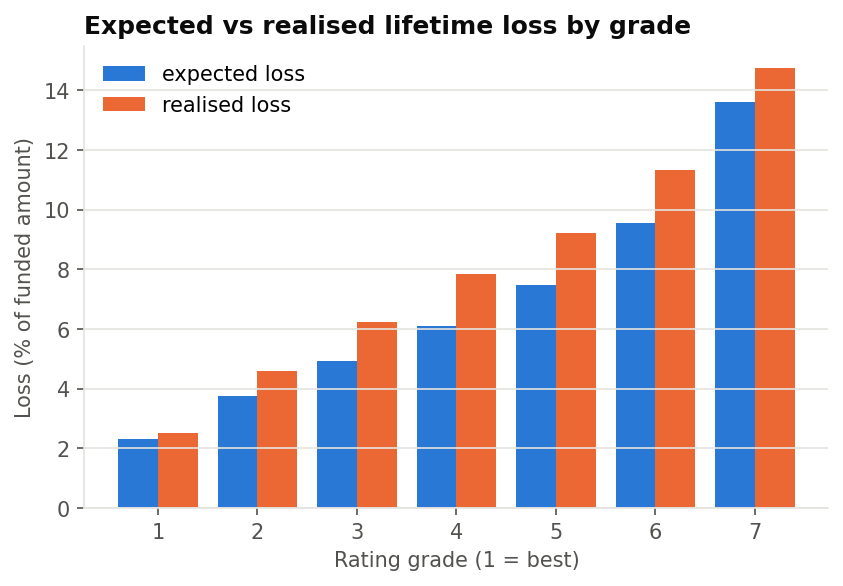

By loan purpose:

| purpose | loans | exposure | exposure_share | mean_pd | observed_dr | el | el_share | el_rate | realised_loss_rate |
|---|---|---|---|---|---|---|---|---|---|
| debt_consolidation | 160,983 | $2,136.9m | 59.0% | 14.07% | 15.73% | $147.1m | 63.9% | 6.88% | 8.03% |
| credit_card | 70,650 | $978.9m | 27.0% | 10.88% | 12.23% | $50.3m | 21.9% | 5.14% | 5.77% |
| home_improvement | 17,160 | $207.3m | 5.7% | 9.77% | 13.51% | $9.5m | 4.1% | 4.60% | 7.57% |
| other | 15,227 | $127.8m | 3.5% | 17.17% | 16.86% | $11.0m | 4.8% | 8.59% | 9.31% |
| major_purchase | 5,342 | $54.7m | 1.5% | 9.04% | 14.45% | $2.3m | 1.0% | 4.18% | 8.55% |
| small_business | 2,425 | $32.8m | 0.9% | 22.33% | 22.97% | $3.7m | 1.6% | 11.32% | 14.43% |
| medical | 3,146 | $23.2m | 0.6% | 16.04% | 17.83% | $1.9m | 0.8% | 8.09% | 10.31% |
| car | 2,768 | $23.2m | 0.6% | 9.73% | 13.29% | $1.1m | 0.5% | 4.79% | 7.86% |
| moving | 2,061 | $14.3m | 0.4% | 16.95% | 20.33% | $1.2m | 0.5% | 8.38% | 12.22% |
| house | 1,004 | $12.0m | 0.3% | 16.61% | 21.61% | $1.0m | 0.4% | 8.27% | 12.27% |
| vacation | 2,071 | $11.7m | 0.3% | 16.05% | 16.32% | $1.0m | 0.4% | 8.14% | 11.09% |
| renewable_energy | 185 | $1.5m | 0.0% | 17.17% | 24.32% | $0.1m | 0.1% | 8.78% | 15.75% |
| wedding | 3 | $0.0m | 0.0% | 10.43% | 0.00% | $0.0m | 0.0% | 5.27% | 0.00% |
| educational | 1 | $0.0m | 0.0% | 18.31% | 0.00% | $0.0m | 0.0% | 9.67% | 0.00% |

By loan size:

| size_band | loans | exposure | exposure_share | mean_pd | observed_dr | el | el_share | el_rate | realised_loss_rate |
|---|---|---|---|---|---|---|---|---|---|
| ≤ $5k | 45,615 | $170.0m | 4.7% | 14.24% | 15.26% | $12.4m | 5.4% | 7.31% | 8.02% |
| $5k–10k | 97,358 | $781.0m | 21.5% | 14.02% | 15.73% | $56.6m | 24.6% | 7.25% | 8.15% |
| $10k–15k | 57,122 | $744.0m | 20.5% | 13.35% | 14.59% | $51.1m | 22.2% | 6.87% | 7.49% |
| $15k–25k | 59,337 | $1,191.2m | 32.9% | 12.00% | 13.97% | $72.1m | 31.3% | 6.06% | 7.18% |
| > $25k | 23,594 | $738.1m | 20.4% | 10.24% | 13.72% | $37.9m | 16.5% | 5.14% | 7.51% |

**Expected loss is $230m, 6.35% of funded principal. The 2015 book actually lost $274m (7.56%),
19% more.** The gap is almost entirely the PD shortfall found in the validation: 42,132 loans
defaulted against 37,304 expected (13% more). Loss severity held up: the realised loss per
default was within 2% of the measured LGD × EAD. The remainder comes from defaults falling on
larger loans than average.

Every grade lost more than expected, by 8% (grade 7) to 28% (grade 4). By purpose, debt
consolidation is 59% of exposure and 64% of expected loss; small-business loans carry the highest
loss rate (11.3% expected, 14.4% realised). Loans above $25k show the largest relative miss (5.1%
expected vs 7.5% realised), matching the validation finding that their PDs are the most
understated.

### 2.3 Sensitivity to PD and LGD

Expected loss as a share of funded amount; PDs scaled (rows), LGDs shifted (columns, capped at 0–100%):

|  | LGD -10% | LGD -5% | LGD +0% | LGD +5% | LGD +10% |
|---|---|---|---|---|---|
| PD x0.8 | 4.51% | 4.80% | 5.08% | 5.37% | 5.65% |
| PD x0.9 | 5.08% | 5.40% | 5.72% | 6.04% | 6.36% |
| PD x1 | 5.64% | 6.00% | 6.35% | 6.71% | 7.06% |
| PD x1.1 | 6.20% | 6.60% | 6.99% | 7.38% | 7.77% |
| PD x1.25 | 7.05% | 7.50% | 7.94% | 8.39% | 8.83% |
| PD x1.5 | 8.46% | 8.99% | 9.53% | 10.06% | 10.60% |

Expected loss moves almost proportionally with both inputs: scaling every PD by 1.25 raises it from
6.35% to 7.94%, and adding 10 points to LGD raises it to 7.06%. The realised 7.56% corresponds to
PDs about 19% higher than the model's; the PD shortfall (13% more defaults than predicted) accounts
for most of that. The PD is the input that matters most here, both because it is the least
accurate and because LGD is already close to its ceiling.

## 3. Credit loss distribution

One-factor Gaussian model, 20,000 scenarios. Asset correlation per loan from the Basel other-retail formula at the loan's annualised PD: 0.030–0.136, EAD-weighted average **ρ = 0.065**.

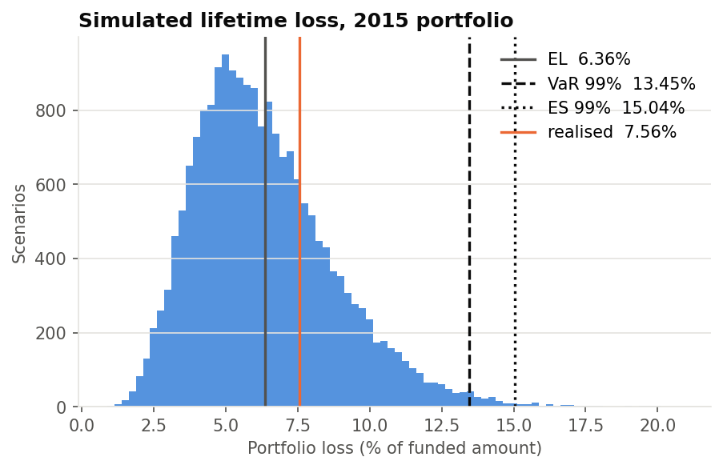

Simulated vs analytical:

|  | simulated | analytical | difference | mc_standard_errors |
|---|---|---|---|---|
| Expected loss | $230.5m | $230.2m | +0.14% | +0.52 |
| VaR 99% (large-portfolio formula) | $487.4m | $487.8m | -0.08% |  |

Monte Carlo convergence (share of funded amount, %):

| scenarios | expected_loss | el_se | var_0.99 | var_0.99_se | es_0.99 | es_0.99_se |
|---|---|---|---|---|---|---|
| 1000 | 6.457 | 0.079 | 13.758 | 0.377 | 15.354 | 0.710 |
| 2000 | 6.512 | 0.056 | 13.757 | 0.271 | 15.388 | 0.550 |
| 5000 | 6.395 | 0.035 | 13.557 | 0.199 | 15.358 | 0.374 |
| 10000 | 6.382 | 0.024 | 13.541 | 0.134 | 15.235 | 0.251 |
| 20000 | 6.361 | 0.017 | 13.449 | 0.094 | 15.044 | 0.153 |

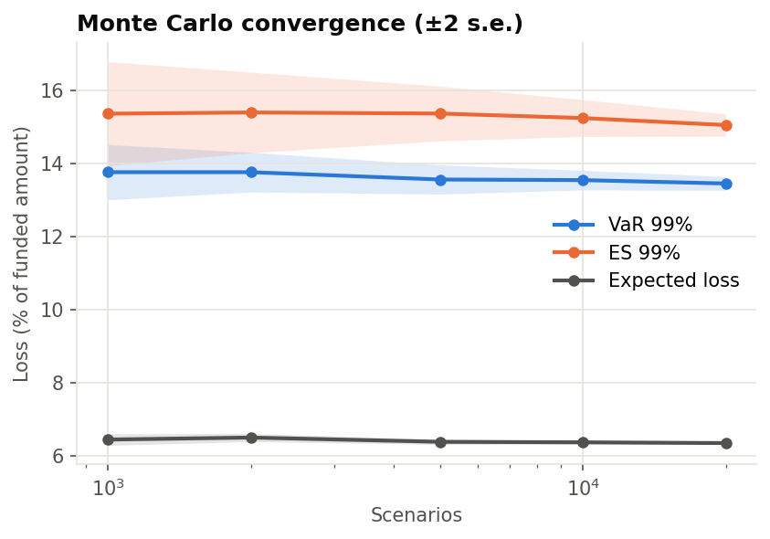

The simulation reproduces the analytical results: simulated expected loss is within 0.14% of
PD × LGD × EAD (0.5 Monte Carlo standard errors), and the simulated 99% VaR is within 0.1% of the
large-portfolio (Vasicek) formula. With 280,000 small loans, idiosyncratic risk diversifies away
and the loss distribution is driven almost entirely by the economy factor. At 20,000 scenarios the
standard error of the 99% VaR is 0.09 points of funded amount, and 0.15 points for the 99% ES.

## 4. VaR and Expected Shortfall

|  | amount | share_of_exposure |
|---|---|---|
| Expected loss | $230.5m | 6.36% |
| Standard deviation | $87.9m | 2.43% |
| VaR 95% | $394.1m | 10.87% |
| VaR 99% | $487.4m | 13.45% |
| ES 97.5% | $493.2m | 13.61% |
| ES 99% | $545.2m | 15.04% |
| Unexpected loss (VaR 99% − EL) | $256.9m | 7.09% |

The realised 2015 loss sits at the **73%** percentile of the simulated
distribution.

At the 99% level the book could lose 13.45% of its funded amount over the loans' life, against an
expected 6.35%. The 7.1-point difference (about $257m) is the unexpected loss that capital would
have to absorb. The 99% Expected Shortfall is 15.0%: in the worst 1% of scenarios, losses average
2.4 times the expected loss.

The realised 2015 loss sits at the 73rd percentile of the simulated distribution: a worse than
expected but unremarkable outcome under this model. That is the result of two offsetting errors,
not a confirmation of the model: the PDs are about 13% too low, and the correlation is an
assumption, not an estimate (section 5).

## 5. Default correlation

Asset correlation per loan from the Basel other-retail formula at the loan's annualised PD: 0.030–0.136, EAD-weighted average **ρ = 0.065**. For comparison, ρ estimated from the data by matching the variance of quarterly
vintage default rates (vintages with at least 1,000 loans) to the one-factor model, after removing
binomial noise:

| Estimate | Default-rate variance | ρ |
|---|---|---|
| Raw vintage default rates | 6.54e-04 | 0.013 |
| Mix-adjusted (default rate ÷ model mean PD) | 2.44e-04 | 0.004 |

Binomial noise variance removed: 2.92e-05; 28 vintages; mean
default rate 13.92%. Simulated with the mix-adjusted estimate instead, the 99% VaR would
be 8.00% of funded amount, and the realised 2015 loss would sit at the
**95.8%** percentile (against 73% in the base case).

| q | n | observed_dr | mean_pd | mix_adjusted_dr |
|---|---|---|---|---|
| 2008Q1 | 1,013 | 23.10% | 16.84% | 18.30% |
| 2009Q2 | 1,098 | 14.39% | 13.17% | 14.58% |
| 2009Q3 | 1,364 | 12.76% | 12.47% | 13.65% |
| 2009Q4 | 1,924 | 13.93% | 12.85% | 14.45% |
| 2010Q1 | 2,172 | 11.69% | 12.77% | 12.22% |
| 2010Q2 | 2,358 | 11.96% | 12.48% | 12.78% |
| 2010Q3 | 2,233 | 10.21% | 12.20% | 11.16% |
| 2010Q4 | 2,393 | 9.86% | 11.81% | 11.14% |
| 2011Q1 | 2,617 | 9.09% | 10.96% | 11.07% |
| 2011Q2 | 3,163 | 10.53% | 11.05% | 12.70% |
| 2011Q3 | 3,951 | 10.60% | 11.17% | 12.67% |
| 2011Q4 | 4,370 | 11.65% | 12.09% | 12.85% |
| 2012Q1 | 6,498 | 13.20% | 12.38% | 14.23% |
| 2012Q2 | 8,469 | 14.23% | 13.08% | 14.51% |
| 2012Q3 | 13,322 | 14.19% | 13.97% | 13.55% |
| 2012Q4 | 15,181 | 12.84% | 13.89% | 12.33% |
| 2013Q1 | 17,988 | 12.59% | 13.72% | 12.23% |
| 2013Q2 | 23,136 | 12.84% | 13.49% | 12.70% |
| 2013Q3 | 27,318 | 12.21% | 13.46% | 12.10% |
| 2013Q4 | 31,980 | 11.91% | 13.17% | 12.06% |
| 2014Q1 | 34,074 | 12.87% | 13.70% | 12.53% |
| 2014Q2 | 37,881 | 13.55% | 13.71% | 13.18% |
| 2014Q3 | 40,595 | 13.63% | 13.66% | 13.31% |
| 2014Q4 | 50,020 | 14.53% | 13.82% | 14.02% |
| 2015Q1 | 56,568 | 14.83% | 13.66% | 14.48% |
| 2015Q2 | 64,222 | 15.38% | 13.40% | 15.31% |
| 2015Q3 | 73,567 | 14.58% | 12.98% | 14.98% |
| 2015Q4 | 88,669 | 14.82% | 12.88% | 15.34% |

Sensitivity of the loss distribution to ρ (share of funded amount, %):

| rho | expected_loss | std | var_0.95 | var_0.99 | es_0.975 | es_0.99 |
|---|---|---|---|---|---|---|
| 0.0 | 6.351 | 0.036 | 6.411 | 6.433 | 6.434 | 6.445 |
| 0.02 | 6.347 | 1.389 | 8.794 | 10.042 | 10.003 | 10.521 |
| 0.05 | 6.342 | 2.211 | 10.367 | 12.619 | 12.565 | 13.512 |
| 0.1 | 6.333 | 3.164 | 12.314 | 15.935 | 15.846 | 17.376 |
| 0.15 | 6.324 | 3.923 | 13.930 | 18.777 | 18.666 | 20.705 |
| 0.2 | 6.315 | 4.589 | 15.407 | 21.385 | 21.252 | 23.741 |

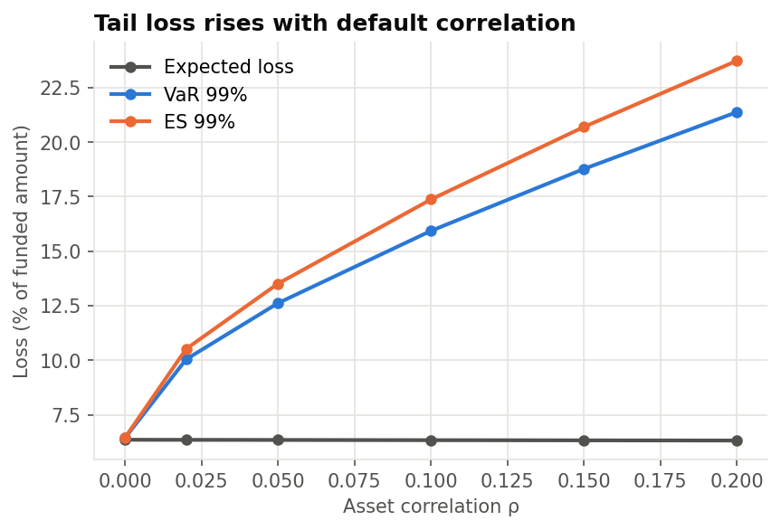

**The default correlation drives the tail more than anything else.** Raising ρ from 0.02 to 0.20
moves the 99% VaR from 10.0% to 21.4% of funded amount, while expected loss stays at 6.35%
(it does not depend on ρ).

The data cannot pin ρ down. Matching the variation of quarterly vintage default rates gives only
0.013, or 0.004 after removing changes in borrower mix that the model already explains. But every
vintage with enough loans was issued between 2009 and 2015, during a steady recovery, so the
estimate measures how much default rates varied in good times only. Used in the simulation, it
would put the realised 2015 loss at about the 96th percentile, a one-in-25 outcome for what was
an ordinary year, which suggests it understates the risk.

The engine therefore uses the Basel other-retail correlation for each loan, a regulatory
benchmark built from data across economic cycles: 0.030–0.136 here, 0.065 on average. It is
evaluated at each loan's annualised PD, assuming a constant default rate over the 36 months.

## 6. Concentration risk

| measure | value |
|---|---|
| Loans | 283,026 |
| Largest single exposure ($) | 35,000 |
| Largest single exposure (share) | 0.001% |
| Top 1% of loans (share of exposure) | 2.7% |
| Herfindahl index, loans | 4.93e-06 |
| Effective number of loans (1 / HHI) | 202,717 |
| Herfindahl index, purpose | 0.426 |
| Largest purpose (share) | debt_consolidation (59.0%) |
| Herfindahl index, grade | 0.145 |
| Largest grade (share) | 1 (16.7%) |
| Herfindahl index, size band | 0.240 |
| Largest size band (share) | $15k–25k (32.9%) |

Random sub-portfolios of the 2015 book, same ρ (share of funded amount, %):

| loans | expected_loss | std | var_0.99 | es_0.99 |
|---|---|---|---|---|
| 100 | 6.635 | 3.097 | 15.177 | 17.103 |
| 500 | 6.454 | 2.550 | 13.758 | 15.117 |
| 2000 | 6.535 | 2.511 | 13.773 | 15.271 |
| 10000 | 6.280 | 2.378 | 13.210 | 14.779 |
| 283026 | 6.356 | 2.413 | 13.603 | 15.071 |

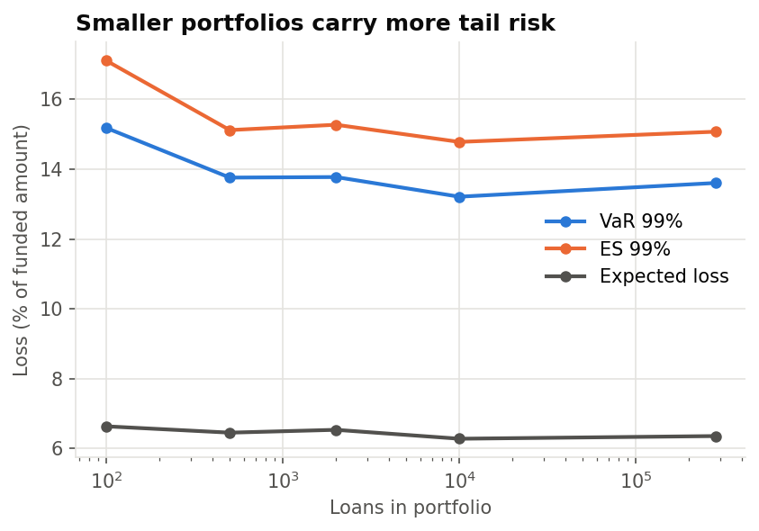

Name concentration is negligible: the largest loan is $35,000 (0.001% of the book), the largest 1%
of loans hold 2.7% of the exposure, and the effective number of equal-sized loans is about
203,000. The real concentration is by purpose: debt consolidation is 59% of exposure (Herfindahl
index 0.43).

Small portfolios carry more tail risk: a random 100-loan portfolio has a 99% VaR of 15.2% of
funded amount against 13.6% for the full book. The add-on fades quickly and is gone by about 500
loans, beyond which systematic risk dominates. Adding loans does not reduce the tail of a large
book; only lower correlation or lower PDs would.

The one-factor model cannot see the purpose concentration: every loan shares the same economy
factor, so a book made entirely of debt-consolidation loans would show no extra correlation. A
model with sector factors would be needed to price that risk.

## 7. Macroeconomic stress testing

Each scenario sets how bad the economy is over the loans' life, through the portfolio model's
economy factor z, and turns each loan's PD into its PD *given* that economy (Vasicek):
PD(z) = Φ((Φ⁻¹(PD) − √ρ·z) / √(1 − ρ)). The base case is the average over all economies, as in
sections 2–4. Severities and add-ons are assumptions, anchored to LendingClub's own history where
possible; they are not estimated macroeconomic relationships.

### 7.1 Scenarios

| scenario | economy | z | lgd_add | ead_add | rho_mult | rate_shock |
|---|---|---|---|---|---|---|
| Base | average |  |  |  | ×1.00 |  |
| Mild recession | 1 in 10 | -1.28 | +2 pts | +3 pts | ×1.00 |  |
| Severe recession | 1 in 50 | -2.05 | +4 pts | +6 pts | ×1.25 |  |
| Interest rate shock | 1 in 5 | -0.84 |  |  | ×1.00 | +300bp |

- `economy`: how rare an economy at least this bad is over a 36-month loan life.
- `lgd_add`, `ead_add`: downturn add-ons to LGD and to the share of principal owed at default.
- `rho_mult`: multiplier on the asset correlation.
- `rate_shock`: rise in interest rates on borrowers' revolving debt, passed through the scorecard via
  debt-to-income.

- **Mild recession:** a 1-in-10 economy over the loans' life, about what LendingClub's 2007 loans
  went through (section 7.2). Unemployment rises moderately, recoveries worsen slightly (LGD +2
  points) and loans default earlier, with more principal still owed (EAD +3 points).
- **Severe recession:** a 1-in-50 economy, worse than anything in LendingClub's history. LGD and
  EAD return to the levels seen on 2007–10 loans (+4 and +6 points), and defaults move together
  more (correlation ×1.25).
- **Interest rate shock:** rates on borrowers' revolving debt rise by 300bp, which raises their
  debt-to-income and feeds through the scorecard, alongside the 1-in-5 slowdown that sharply
  tighter policy usually brings. LGD and EAD are unchanged.

The scenarios describe unemployment and borrowing costs, but the model does not translate
unemployment into the economy factor: nine annual vintages, one of them in a recession, are not
enough to estimate that relationship. Each scenario is set by how rare it is instead, which is
how the portfolio model measures the economy.

### 7.2 Historical anchor

The economy factor at which the model's PDs reproduce each vintage's actual default rate:

| issue_year | loans | observed_dr | mean_pd | implied_z | economy_quantile | return_period_years |
|---|---|---|---|---|---|---|
| 2007 | 603 | 26.20% | 18.96% | -1.31 | 9.5% | 1 in 10.6 |
| 2008 | 2,393 | 20.73% | 15.63% | -1.02 | 15.5% | 1 in 6.5 |
| 2009 | 5,281 | 13.69% | 13.03% | -0.28 | 38.9% | 1 in 2.6 |
| 2010 | 9,156 | 10.92% | 12.30% | +0.16 | 56.2% |  |
| 2011 | 14,101 | 10.63% | 11.39% | +0.01 | 50.3% |  |
| 2012 | 43,470 | 13.58% | 13.53% | -0.15 | 44.1% | 1 in 2.3 |
| 2013 | 100,422 | 12.33% | 13.42% | +0.09 | 53.5% |  |
| 2014 | 162,570 | 13.73% | 13.73% | -0.14 | 44.5% | 1 in 2.2 |
| 2015 | 283,026 | 14.89% | 13.18% | -0.47 | 31.8% | 1 in 3.1 |

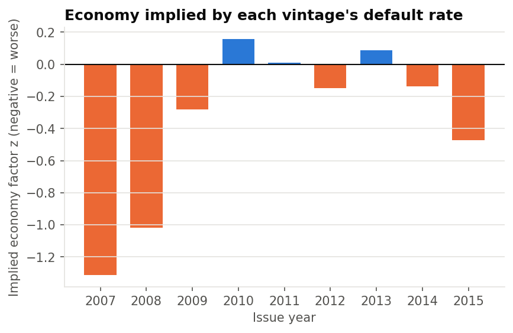

The 2007 and 2008 vintages, issued just before and during the 2008–09 recession, default at
rates that imply 1-in-10.6 and 1-in-6.5 economies. By this measure the recession, as LendingClub's
borrowers experienced it, was roughly a 1-in-10 event, which is where the mild scenario sits; the
severe scenario goes well beyond anything in the data. The anchor is rough: the two vintages are
small (603 and 2,393 loans), they come from LendingClub's first years, when underwriting was
different, and the implied factor absorbs anything else that moved their default rates.

2015 implies a 1-in-3.1 economy: worse than average, although US unemployment fell throughout
2015–18. This is the drift found in the validation, seen through the portfolio model.
The realised 2015 loss of 7.56% sits between the 1-in-3.3 and 1-in-5 points of the economy curve,
which matches.

### 7.3 Expected loss under each scenario

|  | economy | mean_pd | expected_defaults | expected_loss | el_rate | vs_base | base_distribution_percentile |
|---|---|---|---|---|---|---|---|
| Base | average | 13.18% | 37,304 | $230.2m | 6.35% | ×1.00 | 55.7% |
| Mild recession | 1 in 10 | 19.72% | 55,821 | $373.9m | 10.32% | ×1.62 | 93.2% |
| Severe recession | 1 in 50 | 27.02% | 76,486 | $554.3m | 15.29% | ×2.41 | 99.7% |
| Interest rate shock | 1 in 5 | 17.05% | 48,264 | $299.4m | 8.26% | ×1.30 | 80.3% |

`base_distribution_percentile`: where the scenario's loss falls in the base-case loss distribution.

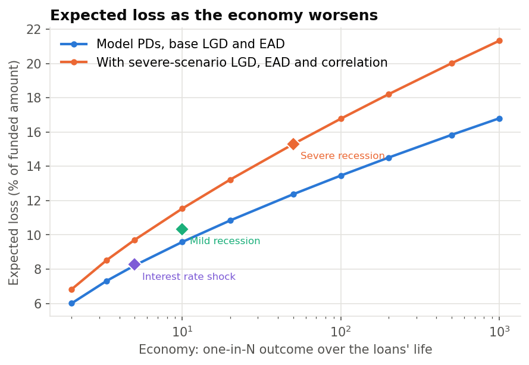

**A mild recession raises lifetime expected loss from 6.35% to 10.32% of funded amount (×1.6);
a severe recession to 15.29% (×2.4), or $554m against $230m.** The interest rate shock gives 8.26%
(×1.3), almost all of it from the slower economy rather than the higher payments (section 7.5).

The severe-recession loss lies at the 99.7th percentile of the base-case distribution, beyond the
base 99% VaR of 13.45%. Capital sized on the base 99% VaR would absorb a mild recession, but not a
severe one with downturn LGD and EAD: on the downturn curve, 13.45% corresponds to roughly a
1-in-20 economy, not 1-in-100.

### 7.4 Stressed loss distributions

Loss distribution with each scenario's PDs, LGD, EAD and correlation as the starting point, and
the economy still uncertain from there (20,000 scenarios each, % of funded amount):

|  | expected_loss | std | var_0.95 | var_0.99 | es_0.975 | es_0.99 |
|---|---|---|---|---|---|---|
| Base | 6.361 | 2.426 | 10.874 | 13.449 | 13.608 | 15.044 |
| Mild recession | 10.328 | 3.492 | 16.710 | 20.080 | 20.225 | 22.010 |
| Severe recession | 15.311 | 5.143 | 24.632 | 29.158 | 29.294 | 31.578 |
| Interest rate shock | 8.272 | 2.922 | 13.652 | 16.581 | 16.725 | 18.307 |

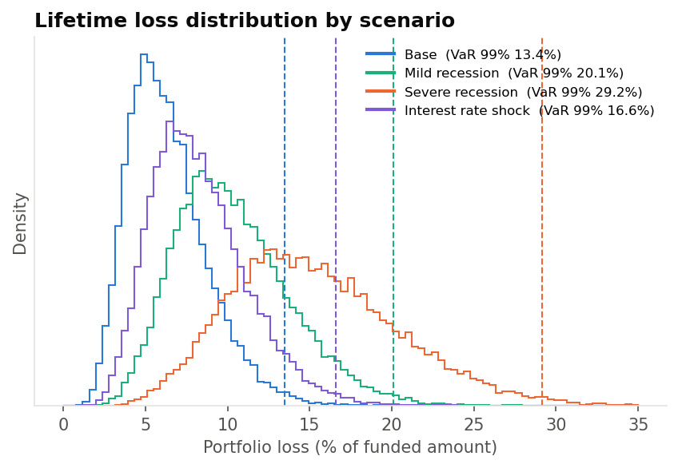

If the book entered each scenario and the economy were still uncertain from there, the 99% VaR
would rise from 13.4% of funded amount (base) to 16.6% (rate shock), 20.1% (mild) and 29.2%
(severe). These figures answer "how bad could it get from here?", so they stack the scenario's
stress on top of further downside. They are the stressed counterpart of the base VaR, not an
estimate of the scenario's own loss, which is the expected loss in section 7.3.

### 7.5 Interest rate shock

A 300bp rise in rates on revolving debt raises
debt-to-income by 0.54 points for the median borrower (1.35 at the 90th percentile).
Expected loss rate by channel:

|  | el_rate |
|---|---|
| Base | 6.35% |
| Payment channel only (+300bp) | 6.39% |
| Economy only (1 in 5) | 8.21% |
| Both (scenario) | 8.26% |

The direct channel barely registers: a 300bp rise on revolving debt adds 0.54 points to the median
borrower's debt-to-income, and lifts expected loss from 6.35% to 6.39%. LendingClub loans are
fixed-rate and its debt-to-income excludes mortgages, so higher rates do not reach most of these
borrowers' payments. Almost all of the scenario's impact (8.21% of the 8.26%) comes from the
economic slowdown that a sharp rate rise brings. A rate shock is a risk to this book through
unemployment, not through payments. The channel modelled here is the narrowest one: variable-rate
mortgages and other floating debt are not in the data.

### 7.6 Portfolio vulnerability

Severe recession against the base case, by rating grade:

| grade | exposure_share | el_rate_base | el_rate_stress | multiple | share_of_increase |
|---|---|---|---|---|---|
| 1 | 16.7% | 2.30% | 8.81% | ×3.83 | 12.1% |
| 2 | 16.5% | 3.75% | 11.70% | ×3.12 | 14.7% |
| 3 | 15.5% | 4.93% | 13.61% | ×2.76 | 15.1% |
| 4 | 14.2% | 6.11% | 15.31% | ×2.50 | 14.6% |
| 5 | 13.4% | 7.48% | 17.13% | ×2.29 | 14.5% |
| 6 | 12.5% | 9.55% | 19.96% | ×2.09 | 14.5% |
| 7 | 11.2% | 13.61% | 25.18% | ×1.85 | 14.4% |

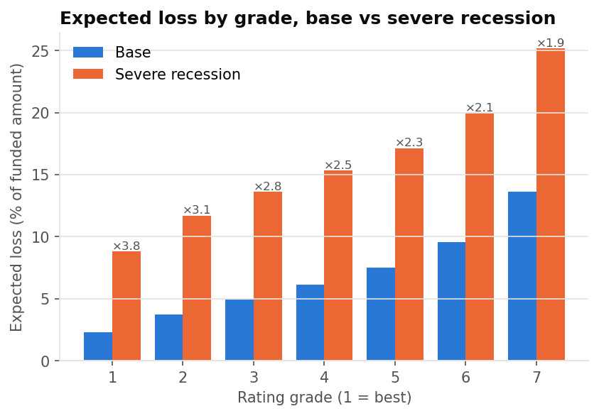

By loan purpose (largest eight by exposure):

| purpose | exposure_share | el_rate_base | el_rate_stress | multiple | share_of_increase |
|---|---|---|---|---|---|
| debt_consolidation | 59.0% | 6.88% | 16.09% | ×2.34 | 60.7% |
| credit_card | 27.0% | 5.14% | 13.54% | ×2.63 | 25.4% |
| home_improvement | 5.7% | 4.60% | 12.66% | ×2.75 | 5.2% |
| other | 3.5% | 8.59% | 18.41% | ×2.14 | 3.9% |
| major_purchase | 1.5% | 4.18% | 11.95% | ×2.86 | 1.3% |
| small_business | 0.9% | 11.32% | 22.02% | ×1.95 | 1.1% |
| medical | 0.6% | 8.09% | 17.76% | ×2.19 | 0.7% |
| car | 0.6% | 4.79% | 12.94% | ×2.70 | 0.6% |

By loan size:

| size_band | exposure_share | el_rate_base | el_rate_stress | multiple | share_of_increase |
|---|---|---|---|---|---|
| ≤ $5k | 4.7% | 7.31% | 16.71% | ×2.29 | 4.9% |
| $5k–10k | 21.5% | 7.25% | 16.58% | ×2.29 | 22.5% |
| $10k–15k | 20.5% | 6.87% | 16.02% | ×2.33 | 21.0% |
| $15k–25k | 32.9% | 6.06% | 14.87% | ×2.46 | 32.4% |
| > $25k | 20.4% | 5.14% | 13.55% | ×2.64 | 19.2% |

- *By grade:* the safest borrowers are hit hardest in relative terms: grade 1's expected loss
  rises 3.8 times, grade 7's 1.9 times. Each grade contributes 12–15% of the extra loss, although
  grade 7 alone holds 24% of the base expected loss. A recession spreads losses across the book,
  so a high-quality book offers less protection than its base expected loss suggests.
- *By purpose:* debt consolidation accounts for 61% of the extra loss (59% of exposure).
  Credit-card refinancing loans are more sensitive (×2.6) than debt consolidation (×2.3), because
  their borrowers are safer to start with.
- *By size:* loans above $25k rise most (×2.6, against ×2.3 for loans under $10k). That compounds
  the validation finding that these loans' PDs are already the most understated.

### 7.7 Sensitivity to the scenario assumptions

Severe recession, one assumption moved at a time (expected loss rate):

| assumption | central | low | high | el_rate_low | el_rate_central | el_rate_high |
|---|---|---|---|---|---|---|
| economy_quantile | 0.02 | 0.04 | 0.01 | 13.74% | 15.29% | 16.78% |
| pd_scale | 1 | 0.9 | 1.13 | 14.09% | 15.29% | 16.81% |
| ead_add | 0.06 | 0 | 0.1 | 13.84% | 15.29% | 16.26% |
| rho_mult | 1.25 | 1 | 1.5 | 14.28% | 15.29% | 16.25% |
| lgd_add | 0.04 | 0 | 0.08 | 14.64% | 15.29% | 15.95% |

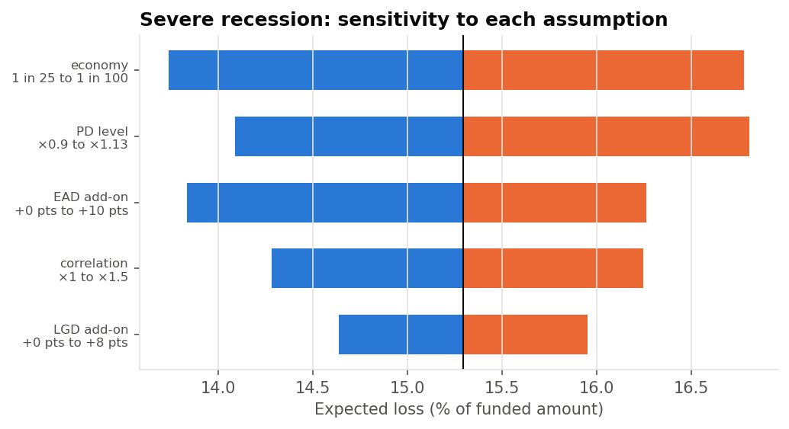

Expected loss rate across economies:

| economy | Model PDs, base LGD and EAD | With severe-scenario LGD, EAD and correlation |
|---|---|---|
| 1 in 2 | 6.00% | 6.82% |
| 1 in 3.33 | 7.32% | 8.53% |
| 1 in 5 | 8.21% | 9.71% |
| 1 in 10 | 9.59% | 11.54% |
| 1 in 20 | 10.84% | 13.22% |
| 1 in 50 | 12.37% | 15.29% |
| 1 in 100 | 13.46% | 16.78% |
| 1 in 200 | 14.51% | 18.21% |
| 1 in 500 | 15.83% | 20.01% |
| 1 in 1e+03 | 16.80% | 21.33% |

Two assumptions matter most for the severe scenario. **Severity** (1-in-25 to 1-in-100) moves the
expected loss between 13.7% and 16.8%. The **PD level** moves it between 14.1% and 16.8%: removing
the 2015 calibration gap (PDs ×1.13) adds as much loss as moving from a 1-in-50 to a 1-in-100
economy. The downturn EAD (13.8–16.3%) and correlation (14.3–16.3%) come next. LGD matters least
(14.6–16.0%) because it is already close to 100%.

### 7.8 Reverse stress test

How rare an economy would have to be for lifetime losses to reach each level:

| lifetime loss reaches | base LGD and EAD: economy_quantile | base LGD and EAD: return_period_years | downturn LGD, EAD and correlation: economy_quantile | downturn LGD, EAD and correlation: return_period_years |
|---|---|---|---|---|
| 8% | 22.1% | 1 in 5 | 35.5% | 1 in 3 |
| 10% | 8.0% | 1 in 12 | 18.0% | 1 in 6 |
| 15% | 0.4% | 1 in 280 | 2.3% | 1 in 44 |
| 20% | 0.009% | 1 in 11,606 | 0.2% | 1 in 497 |

Lifetime losses reach 10% of funded amount in a 1-in-12 economy with today's LGD and EAD, or a
1-in-6 economy with downturn LGD, EAD and correlation. 15% needs a 1-in-280 economy, or 1-in-44
with downturn assumptions. 20% needs a 1-in-11,606 or 1-in-497 economy. The downturn assumptions
shorten these return periods by a factor of 2 to 23, so they matter as much as the severity of the
economy itself.

## 8. Portfolio optimisation

An investor who buys LendingClub notes at par and holds them to the end chooses how to spread money
across **segments: our rating grade × LendingClub grade** (E, F and G merged; segments with fewer than
500 loans left out, which leaves 99.6% of the 2015 book). Everything used to
choose is known when the loans are issued; each choice is then scored on what the 2015 loans actually
returned. Returns are **lifetime net returns per dollar**, after a 1% servicing fee
and collection fees.

### 8.1 Inputs and assumptions

Expected return per loan = (1 − PD) × cash if repaid + PD × cash if defaulted − 1, where interest earned
is the rate times a factor measured on 2007–2014 loans (it captures prepayment
and time to default), and the cash from a default comes from the measured EAD and LGD:

| lc_band | loans | k_good | k_bad |
|---|---|---|---|
| A | 72,888 | 1.331 | 1.101 |
| B | 120,242 | 1.341 | 1.087 |
| C | 84,979 | 1.330 | 1.052 |
| D | 43,952 | 1.336 | 1.009 |
| E–G | 15,935 | 1.338 | 0.954 |

| Assumption | Value |
|---|---|
| Purchase price | Par, no purchase fee |
| Servicing fee | 1% of every borrower payment; recoveries net of the recorded collection fee |
| Holding | To maturity: no secondary-market sales, so no liquidity cost or price risk |
| Prepayment | In the interest factors above, measured on earlier loans |
| Limits | At most 10% per segment and 35% per LendingClub band; no short positions |
| Tail risk | 99% CVaR of lifetime return over 10,000 economies from the one-factor model |
| Annualised return | Approximate: gain ÷ principal outstanding over time, following each loan's schedule to its last payment (+5 months for defaults) |

Repaid loans earned 1.33–1.34 times their interest rate per dollar over their life, in every band:
less than the 1.6 or so a 36-month loan pays if it runs to term, because many borrowers repaid early.
Defaulted loans earned 0.95–1.10 times their rate before they stopped paying, and less in the riskier
bands, where loans default sooner. Both factors come from 2007–14 loans.

The backtest is out of sample by vintage, not a real-time simulation: parameters come from loans issued
up to 2014, but an investor in 2015 could not yet have seen how 2013–14 loans turned out. The same
convention runs through the validation (the recalibration is fitted on 2014 outcomes).

### 8.2 Strategies and results

| strategy | what it does |
|---|---|
| Whole book | every loan, in proportion to its size (benchmark) |
| Equal weight | the same amount in every segment |
| Max expected return | highest expected return within the limits |
| Min expected loss | lowest expected loss within the limits |
| Min CVaR | lowest 99% CVaR within the limits |
| Max return, CVaR ≤ book | highest expected return with 99% CVaR no worse than the whole book's |
| Max return, EL ≤ book | highest expected return with expected loss no higher than the whole book's |

| strategy | expected_return | el_rate | cvar_0.99 | realised_return | realised_annualised | realised_loss_rate | segments_held | largest_weight |
|---|---|---|---|---|---|---|---|---|
| Whole book | 6.86% | 6.37% | 2.24% | 5.30% | 4.03% | 7.54% | 32 | 12.0% |
| Equal weight | 8.29% | 7.19% | 1.20% | 4.45% | 3.43% | 10.12% | 32 | 3.1% |
| Max expected return | 14.91% | 5.35% | -5.46% | 3.74% | 3.07% | 14.08% | 11 | 10.0% |
| Min expected loss | 9.10% | 3.71% | -0.67% | 6.31% | 4.89% | 5.74% | 10 | 10.0% |
| Min CVaR | 14.91% | 5.35% | -5.46% | 3.74% | 3.07% | 14.08% | 11 | 10.0% |
| Max return, CVaR ≤ book | 14.91% | 5.35% | -5.46% | 3.74% | 3.07% | 14.08% | 11 | 10.0% |
| Max return, EL ≤ book | 14.91% | 5.35% | -5.46% | 3.74% | 3.07% | 14.08% | 11 | 10.0% |

With hindsight, the best portfolio allowed by the same limits would have returned
**6.34%**.

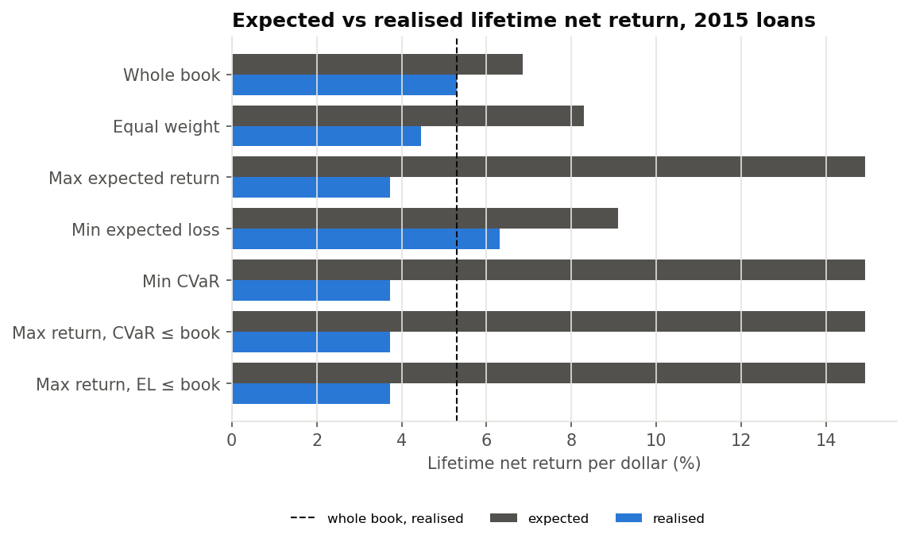
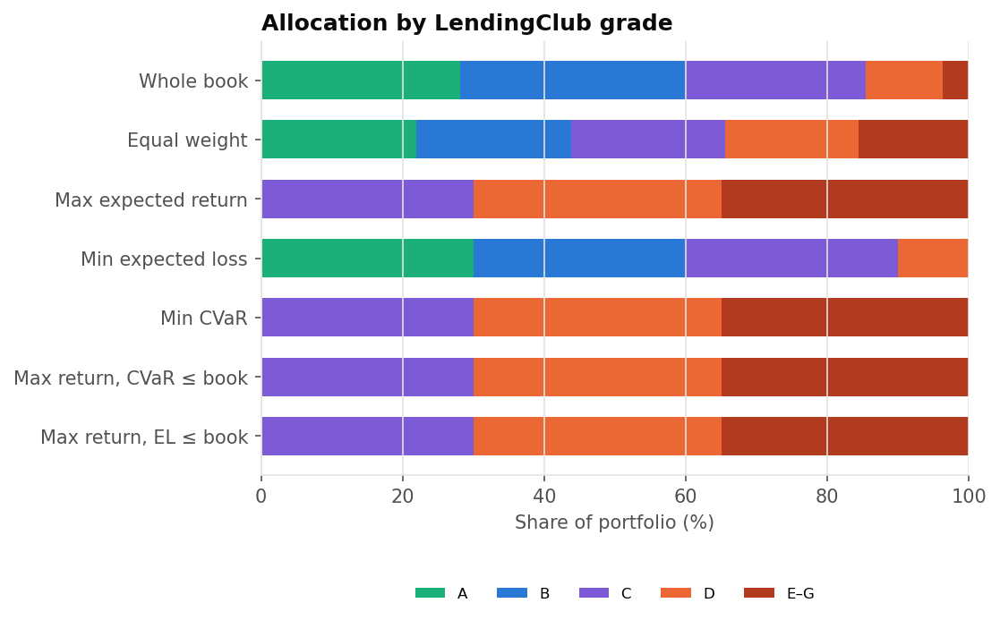
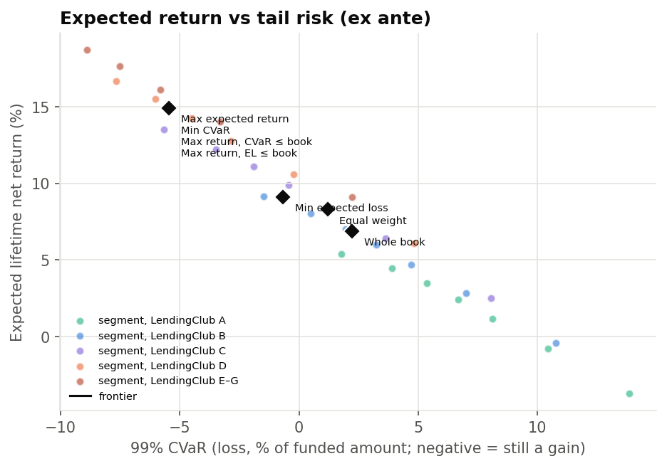

**Every strategy that reached for expected return did worse than buying the whole book; the one that
minimised expected loss did best.**

- *Whole book:* 5.30% lifetime net return (about 4.0% a year), against 6.86% expected.
- *Min expected loss:* 6.31%, a point above the book and within 0.03 points of the best result
  possible with hindsight under the same limits (6.34%). It holds our three best grades, almost all in
  LendingClub's A–C bands.
- *Max expected return:* 3.74%, against 14.91% expected: 1.6 points below the book and 11 points
  below its own forecast. It put all its money in LendingClub's C, D and E–G bands (the 35% limit in
  each of D and E–G), and 14.1% of its money was lost to defaults, against 7.5% for the whole book.
- *Min CVaR, and max return with a CVaR or expected-loss limit:* the same portfolio as max return.
  Under the scorecard model, the high-rate segments have the highest expected return *and* the lowest
  tail risk, because their rates appear to cushion losses even in bad economies. The model sees no
  trade-off between risk and return (section 8.1 chart), so the risk limits never bind.
- *Equal weight:* 4.45%, because it gives small, risky segments the same weight as large, safe ones.

### 8.3 Why reaching for return failed

Expected and realised return by LendingClub grade band, 2015 loans:

| lc_band | loans | mean_rate | mean_pd | observed_dr | k_good_assumed | k_good_realised | default_cash_assumed | default_cash_realised | expected_return | expected_return_at_actual_dr | realised_return |
|---|---|---|---|---|---|---|---|---|---|---|---|
| A | 70,118 | 6.9% | 8.1% | 5.4% | 1.331 | 1.331 | 0.584 | 0.624 | 4.18% | 5.41% | 5.76% |
| B | 91,725 | 10.0% | 12.4% | 11.9% | 1.341 | 1.317 | 0.602 | 0.623 | 6.01% | 6.08% | 6.22% |
| C | 77,423 | 13.2% | 15.6% | 19.4% | 1.330 | 1.295 | 0.620 | 0.608 | 8.25% | 5.91% | 5.22% |
| D | 32,711 | 16.6% | 18.1% | 26.2% | 1.336 | 1.274 | 0.641 | 0.588 | 11.12% | 6.15% | 3.47% |
| E–G | 11,049 | 19.8% | 20.8% | 34.3% | 1.338 | 1.266 | 0.654 | 0.571 | 13.07% | 4.57% | 0.08% |

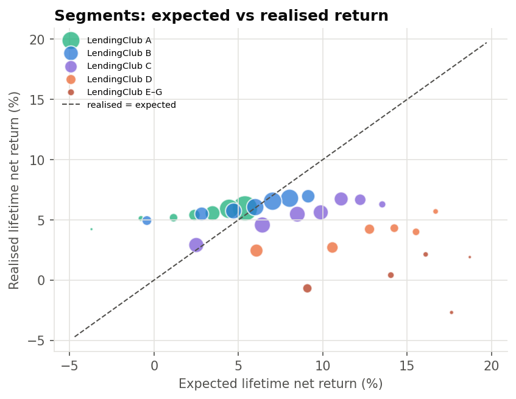

Three things went wrong in the riskier bands, and all three get worse as the rate rises:

1. **The PD is too flat across LendingClub's grades.** For E–G loans the scorecard predicts 20.8% and
   34.3% defaulted; for A loans it predicts 8.1% and 5.4% defaulted. LendingClub's grade contains risk
   information the scorecard leaves out, and the default-rate drift found in the validation was
   concentrated in the riskiest bands (E–G defaults rose from 24% on 2007–13 loans to 34% on 2015 loans).
2. **High-rate borrowers repaid early more often,** earning 1.27 times their rate instead of the
   assumed 1.34.
3. **High-rate loans defaulted earlier,** so less principal had been repaid: 0.57 of each dollar came
   back from E–G defaults, against 0.65 assumed.

For E–G loans, the expected 13.1% falls to 4.6% with the actual default rate, and to 0.1% once
prepayment and recoveries are as realised. An optimiser maximises exactly where its inputs are most
wrong, so these errors end up concentrated in its portfolio.

### 8.4 Sensitivity to the return inputs

The same strategies with two other sources of expected return: the **price-informed model** scales each
segment's PD by its actual-to-predicted default ratio on 2007–2014 loans, which
brings in LendingClub's grade; **segment history** uses each segment's realised return on those loans.

| strategy | Scorecard model: expected | Scorecard model: realised | Price-informed model: expected | Price-informed model: realised | Segment history: expected | Segment history: realised |
|---|---|---|---|---|---|---|
| Whole book | 6.86% | 5.30% | 7.02% | 5.30% | 8.45% | 5.30% |
| Equal weight | 8.29% | 4.45% | 7.86% | 4.45% | 8.83% | 4.45% |
| Max expected return | 14.91% | 3.74% | 11.94% | 3.74% | 11.74% | 4.48% |
| Min expected loss | 9.10% | 6.31% | 7.80% | 6.31% | 9.86% | 6.31% |
| Min CVaR | 14.91% | 3.74% | 11.85% | 4.06% | 11.68% | 5.08% |
| Max return, CVaR ≤ book | 14.91% | 3.74% | 11.94% | 3.74% | 11.74% | 4.48% |
| Max return, EL ≤ book | 14.91% | 3.74% | 11.14% | 4.80% | 11.74% | 4.48% |

Correlation between each input's expected returns and the realised 2015 returns, across segments:
scorecard model -0.35, price-informed -0.26,
segment history -0.01.

Neither alternative input rescues the return-seeking strategies. With the **price-informed model**, the
expected-loss limit now binds and lifts the result from 3.74% to 4.80%, the best of the return seekers,
but still half a point below the whole book. With **segment history**, minimising CVaR returns 5.08%,
also below the book. History is no guide here: the D and E–G segments returned 6–14% on 2007–14 loans
and between −3% and 6% on 2015 loans, so history's expected returns are uncorrelated with what happened
(−0.01 across segments), and both model-based inputs are negatively correlated (−0.35 and −0.26).

Minimising expected loss returns 6.31% under both PD inputs (the history input reuses the scorecard's
expected loss), because the lowest-loss segments, our best grades in LendingClub's A and B bands, are
much the same either way.

Per-segment inputs and outcomes:

| seg | loans | exposure | mean_pd | mean_rate | expected_return | el_rate | observed_dr | realised_return | realised_annualised |
|---|---|---|---|---|---|---|---|---|---|
| 1 / A | 28,038 | $434.0m | 4.7% | 6.5% | 5.39% | 2.22% | 3.5% | 5.95% | 4.50% |
| 1 / B | 7,948 | $124.1m | 5.3% | 9.6% | 9.13% | 2.51% | 7.6% | 6.96% | 5.53% |
| 1 / C | 2,199 | $35.9m | 5.4% | 13.0% | 13.52% | 2.55% | 13.1% | 6.28% | 5.25% |
| 2 / A | 17,682 | $257.9m | 7.7% | 7.0% | 4.45% | 3.70% | 5.7% | 5.91% | 4.35% |
| 2 / B | 15,773 | $223.6m | 7.8% | 9.8% | 8.03% | 3.77% | 9.6% | 6.79% | 5.19% |
| 2 / C | 6,176 | $90.9m | 7.9% | 13.1% | 12.22% | 3.80% | 15.3% | 6.67% | 5.29% |
| 2 / D | 1,359 | $22.6m | 8.0% | 16.5% | 16.68% | 3.82% | 19.9% | 5.70% | 4.68% |
| 3 / A | 11,047 | $152.4m | 9.9% | 7.2% | 3.46% | 4.89% | 6.4% | 5.55% | 4.05% |
| 3 / B | 17,863 | $228.3m | 10.0% | 9.9% | 7.02% | 4.93% | 11.1% | 6.55% | 4.93% |
| 3 / C | 9,937 | $134.5m | 10.1% | 13.1% | 11.09% | 4.95% | 15.7% | 6.73% | 5.28% |
| 3 / D | 2,663 | $40.1m | 10.1% | 16.6% | 15.52% | 4.97% | 22.6% | 4.00% | 3.29% |
| 3 / E–G | 524 | $7.9m | 10.1% | 19.3% | 18.71% | 4.99% | 29.2% | 1.91% | 1.64% |
| 4 / A | 6,921 | $90.5m | 12.2% | 7.3% | 2.39% | 6.08% | 7.6% | 5.39% | 3.91% |
| 4 / B | 16,900 | $202.9m | 12.2% | 10.1% | 6.00% | 6.11% | 12.4% | 6.06% | 4.52% |
| 4 / C | 12,576 | $155.8m | 12.3% | 13.2% | 9.88% | 6.13% | 18.0% | 5.62% | 4.37% |
| 4 / D | 3,836 | $52.4m | 12.3% | 16.6% | 14.24% | 6.15% | 23.2% | 4.31% | 3.54% |
| 4 / E–G | 873 | $12.6m | 12.3% | 19.4% | 17.63% | 6.16% | 31.3% | -2.69% | -2.32% |
| 5 / A | 3,953 | $50.2m | 14.6% | 7.4% | 1.15% | 7.40% | 8.3% | 5.18% | 3.71% |
| 5 / B | 15,129 | $172.8m | 14.7% | 10.1% | 4.71% | 7.46% | 13.1% | 5.73% | 4.25% |
| 5 / C | 14,750 | $170.5m | 14.8% | 13.2% | 8.49% | 7.49% | 18.9% | 5.47% | 4.19% |
| 5 / D | 5,639 | $72.5m | 14.9% | 16.6% | 12.77% | 7.52% | 24.8% | 4.22% | 3.34% |
| 5 / E–G | 1,516 | $21.1m | 14.9% | 19.5% | 16.09% | 7.53% | 32.3% | 2.13% | 1.75% |
| 6 / A | 1,919 | $23.5m | 17.8% | 7.5% | -0.78% | 9.41% | 9.9% | 5.11% | 3.62% |
| 6 / B | 11,790 | $130.6m | 18.0% | 10.3% | 2.82% | 9.49% | 14.4% | 5.49% | 4.02% |
| 6 / C | 16,310 | $177.0m | 18.1% | 13.3% | 6.42% | 9.56% | 21.3% | 4.57% | 3.46% |
| 6 / D | 7,699 | $90.3m | 18.2% | 16.6% | 10.57% | 9.60% | 27.1% | 2.71% | 2.13% |
| 6 / E–G | 2,432 | $31.2m | 18.3% | 19.7% | 14.03% | 9.66% | 33.6% | 0.41% | 0.33% |
| 7 / A | 558 | $6.3m | 22.6% | 7.6% | -3.71% | 12.43% | 13.1% | 4.22% | 2.94% |
| 7 / B | 6,322 | $66.0m | 23.4% | 10.5% | -0.43% | 12.85% | 16.7% | 4.94% | 3.58% |
| 7 / C | 15,475 | $156.2m | 24.5% | 13.4% | 2.50% | 13.42% | 24.1% | 2.91% | 2.17% |
| 7 / D | 11,067 | $116.6m | 25.4% | 16.7% | 6.07% | 13.87% | 29.4% | 2.45% | 1.87% |
| 7 / E–G | 5,362 | $59.5m | 26.8% | 20.1% | 9.08% | 14.55% | 36.9% | -0.69% | -0.54% |

## 9. Risk management implications

1. **Expected loss is understated by about 16%** (it would have needed to be 19% higher to match
   the realised loss) for as long as the PD level lags the default rate. Provisions based on these
   PDs would have been too low for 2015. The validation recommendations (recalibrate on the latest
   mature vintage, add a time-varying calibration) apply directly here.
2. **Capital is a correlation decision.** At the Basel retail correlation the 99% lifetime
   unexpected loss is 7.1% of funded amount; at ρ = 0.10 it would be about 9.6%. ρ should be set
   and reviewed as a governed assumption.
3. **Purpose concentration is the main unmodelled risk.** It is worth a limit, or a two-factor
   model, rather than more diversification by loan count.
4. **LGD is stable and high**, so there is little to gain from refining it. Effort is better spent
   on the PD level.
5. **Plan for a mild recession as a realistic case.** It raises lifetime losses by about 60% (to
   10.3%), and the base 99% VaR covers it. A severe recession (15.3%) exceeds that buffer once LGD
   and EAD worsen. Buffer and limit-setting should be based on the downturn curve, not the base
   case alone.
6. **The safest loans are not a hedge.** Grade 1 losses rise almost four times in a severe
   recession, and every grade contributes a similar share of the extra loss.
7. **Interest-rate risk runs through the economy.** Monitoring for this book should track
   unemployment and credit conditions rather than borrowers' payment burden.
8. **Select on low expected loss, not high expected return.** In the 2015 backtest, minimising expected
   loss beat the whole book by a point and matched the hindsight optimum; every return-seeking strategy
   lost to the book.
9. **Treat optimiser output as a stress test of the inputs.** When an optimiser concentrates in the
   highest-rate loans and reports no trade-off between return and tail risk, that is a sign of input
   error. Risk limits measured with the same inputs do not protect against it; limits measured
   independently (here, a price-informed PD) help a little.

## 10. Model assumptions and limitations

- *Lifetime horizon:* every figure covers the loans' 36-month life, not one year, so it cannot be
  compared directly with Basel one-year capital or IFRS 9 12-month expected loss.
- *Gaussian one-factor dependence:* one economy factor, no sector or regional factors, no tail
  dependence beyond what ρ implies, and the same ρ formula for every purpose.
- *LGD independent of the economy:* in a downturn, recoveries typically fall as defaults rise. The
  base case has no downturn LGD; the stress scenarios add fixed downturn add-ons to LGD and EAD,
  anchored on 2007–11 charge-offs rather than estimated.
- *Scenario severities are assumptions:* they are set by how rare they are, anchored on two small
  early vintages, not on an estimated link from unemployment or rates to defaults.
- *Rate shock covers revolving debt only:* the data does not show mortgages or other floating-rate
  debt, so the payment channel is a lower bound.
- *Correlation is assumed:* the Basel formula is calibrated for one-year PDs on bank retail books,
  and is applied here at annualised PDs under a constant-hazard assumption.
- *Loss parameters by grade only:* LGD and EAD vary by rating grade but not by purpose or loan size.
- *Recoveries may be incomplete:* 25% of 2014 charge-offs show no recovery, so recent LGDs may be
  slightly overstated.
- *PD inherited from the scorecard:* the expected loss carries the scorecard's calibration gap.
- *Optimisation is a one-vintage backtest:* one year of loans in one economic environment, with
  parameters that an investor in 2015 could not yet have fully seen. It shows how the strategies
  behaved in 2015, not how they would behave in general.
- *Returns are lifetime per dollar,* not time-weighted; annual figures are approximate. Strategies
  hold different mixes of loans that run for different lengths of time, and reinvestment is ignored.
- *Segments are bought pro rata:* every loan in a chosen segment, at the same weight, held to maturity.
  No secondary-market trading, purchase limits or taxes.
