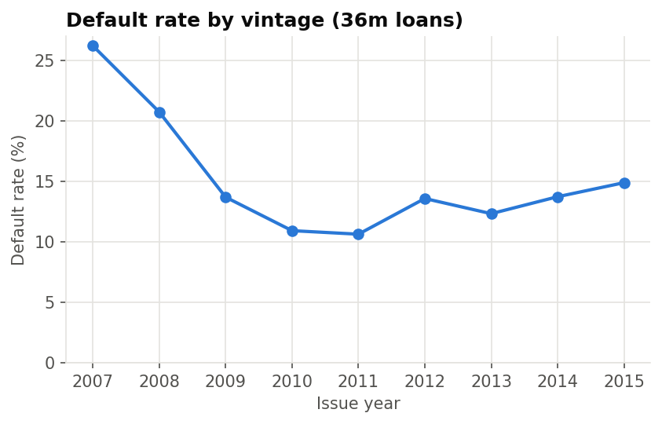
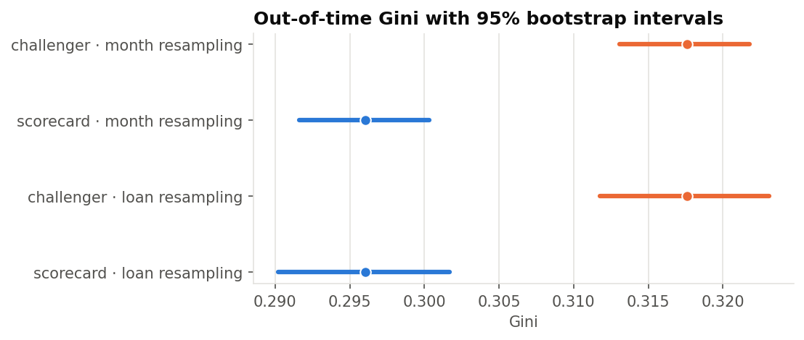
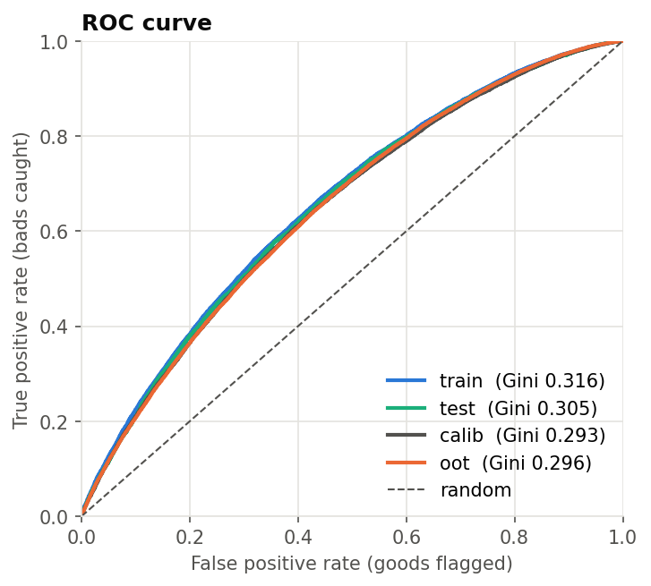
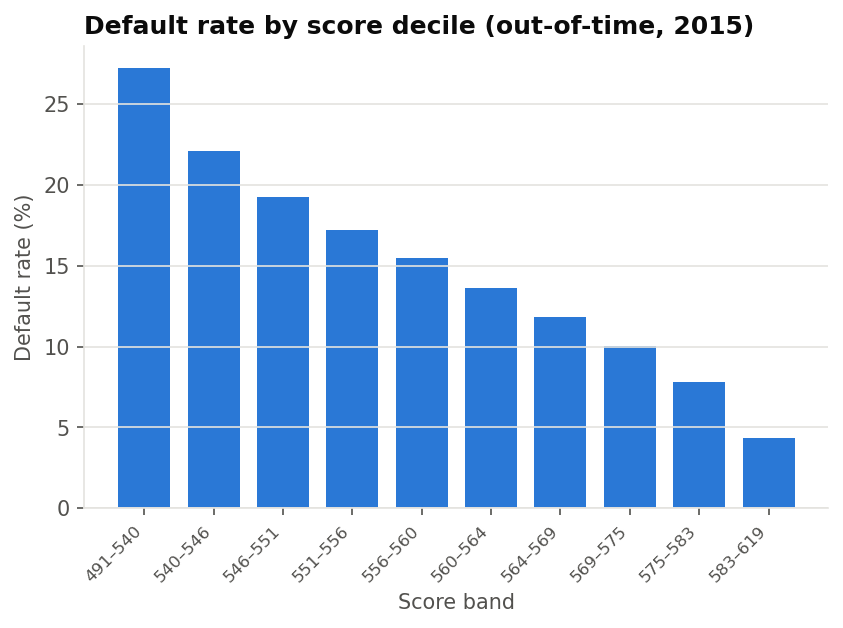
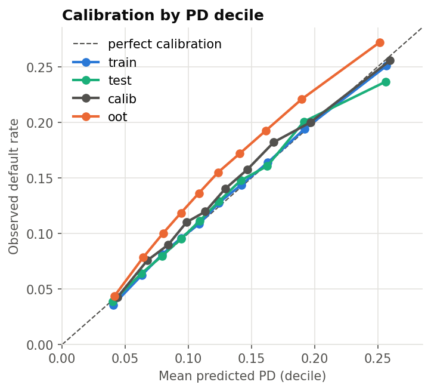
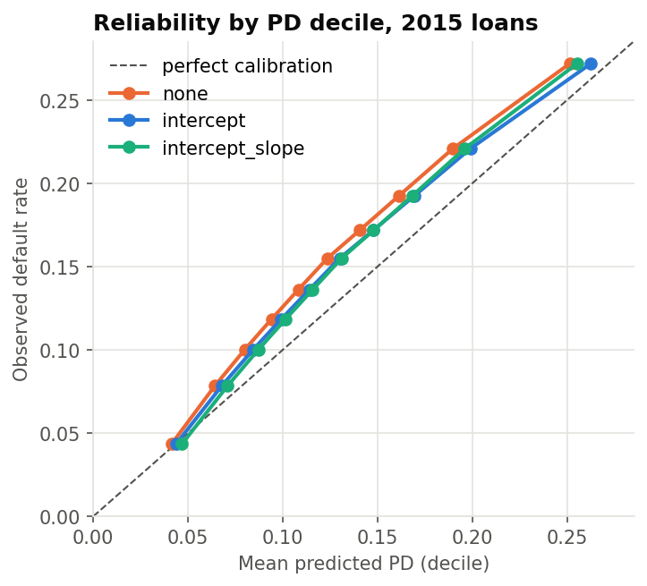
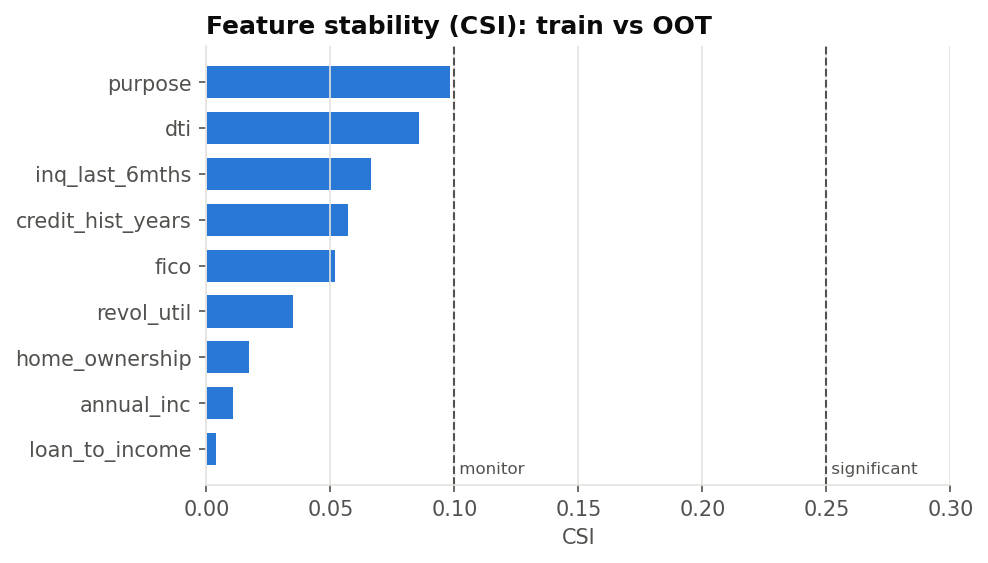

# PD Scorecard — Model Validation Report

*Generated by `scripts/run_pipeline.py` from the latest run. Commentary: `reports/commentary.md`.
Data audit: [`data_audit.md`](data_audit.md). Limitations: [`limitations_register.md`](limitations_register.md).*

## 1. Executive summary

| Item | Value |
|---|---|
| Model | Logistic regression on WoE-binned application features (scorecard), recalibrated on 2014 loans (intercept) |
| Portfolio | LendingClub 36-month unsecured consumer loans |
| Target | Default = charged off over the loan's life (36-month horizon) |
| Final features | 9: `fico`, `annual_inc`, `loan_to_income`, `inq_last_6mths`, `purpose`, `dti`, `revol_util`, `home_ownership`, `credit_hist_years` |
| Scaling | 600 points at 30:1 good:bad odds, PDO = 20 |
| Decision, model as developed | **Recalibrate** (RED calibration with a sound ranking) |
| Decision, recalibrated model | **Recalibrate** (RED calibration with a sound ranking) |

| # | dimension | as developed | recalibrated | evidence (recalibrated) |
|---|---|---|---|---|
| 1 | Conceptual soundness | GREEN | GREEN | 0 coefficients with the wrong sign; largest p-value 0.004; largest VIF 1.51; monotonic WoE bins: yes |
| 2 | Data quality | GREEN | GREEN | 5 of 5 checks passed. |
| 3 | Target definition | GREEN | GREEN | 4 of 4 checks passed. |
| 4 | Model discrimination | RED | RED | Out-of-time Gini 0.296 (95% CI 0.292–0.300); thresholds GREEN ≥ 0.4, AMBER ≥ 0.3 |
| 5 | Model calibration | RED | RED | Mean PD minus observed default rate -1.71%; 6 of 7 grades fail the binomial test |
| 6 | Population stability | GREEN | GREEN | Score PSI 0.001; largest feature CSI 0.098 |
| 7 | Out-of-time performance | GREEN | GREEN | Gini falls 6.2% from train to out-of-time; rank ordering monotonic across deciles |
| 8 | Challenger comparison | GREEN | GREEN | Challenger Gini minus scorecard +0.022 (95% CI +0.018 to +0.024); material at ≥ 0.03 |
| 9 | Sensitivity analysis | GREEN | GREEN | Out-of-time Gini range across alternative specifications 0.015; coefficient uncertainty moves mean PD by ±1.7% |
| 10 | Model limitations | AMBER | AMBER | 11 limitations in the register, 3 rated High |

**Decision: Recalibrate. The scorecard ranks risk consistently, but its PD level does not hold
from one year to the next, and a recalibration fitted on 2014 loans is not enough for 2015.**

- *Ranking holds up out of time.* On 2015 loans, which the model never saw, Gini is 0.296 (95%
  interval 0.292–0.300), only 6% below train. Default rates fall monotonically across all ten score
  deciles, from 27.2% to 4.3%, and the score distribution is stable (PSI 0.001).
- *Discrimination is modest.* 0.296 is just below this project's 0.30 threshold. Gradient boosting
  on the same data does better by only 0.022 Gini, below the 0.03 materiality threshold, so a more
  complex model would not fix this.
- *The PD level drifts.* The model as developed predicts 12.54% on 2015 loans against 14.89%
  observed. Re-fitting the intercept on 2014 loans raises the prediction to 13.18%, which closes
  only about a quarter of the gap: 6 of 7 grades still fail the binomial test.
- *A robustness weakness.* Leaving income or recent credit inquiries blank lowers a borrower's PD
  by 13–19%, because those fields were almost never missing in training (section 9).

The PDs should not be used for pricing, provisioning or capital until a recalibration has been
shown to hold on a later, unseen vintage. See section 12.

## 2. Model purpose and scope

**Purpose.** Estimate the probability that a 36-month unsecured LendingClub loan is charged off
over its life, from information available at application, and rank applicants by that risk.

**Intended uses.** Ranking and approving applicants against a cut-off; the PD input to lifetime
expected-loss and portfolio-risk estimates (`reports/portfolio_risk_report.md`).

**Out of scope.** 60-month loans; 12-month PDs for Basel IRB capital or IFRS 9 stage 1; any
population that LendingClub's approval process did not filter (see the limitations register, L1).

**Validation scope.** Data and target, conceptual soundness, discrimination, calibration,
stability, out-of-time performance, challenger comparison and sensitivity. The test sample is
2015 loans, used once, after the recalibration method was chosen on 2014 loans alone.

## 3. Data assessment

| sample | n_loans | n_defaults | default_rate | first_issue | last_issue |
|---|---|---|---|---|---|
| train | 122,798 | 15,510 | 12.63% | 2007-06 | 2013-12 |
| test | 52,628 | 6,647 | 12.63% | 2007-06 | 2013-12 |
| calib | 162,570 | 22,315 | 13.73% | 2014-01 | 2014-12 |
| oot | 283,026 | 42,132 | 14.89% | 2015-01 | 2015-12 |

| check | result | evidence |
|---|---|---|
| Fully paid loans are non-defaults | PASS | Both 'Fully Paid' statuses map to 0, and over 99% of them repaid the funded principal |
| Charged-off and defaulted loans are defaults | PASS | Charged Off, Default, Does not meet the credit policy. Status:Charged Off map to 1 |
| Unresolved loans excluded, and rare in modelled vintages | PASS | 0.02% of 2007–2015 36-month loans unresolved (highest: 2015, 0.05%) |
| Every modelled vintage observed for its full 36-month term | PASS | Snapshot Mar 2019; shortest window 39 months |
| No post-origination field among the candidate features | PASS | 18 candidate features checked against 22 outcome fields |
| Final model uses no post-origination field | PASS | 9 model features checked |
| Samples separated in time (train/test < calibration < out-of-time) | PASS | train 2007-06–2013-12 · test 2007-06–2013-12 · calib 2014-01–2014-12 · oot 2015-01–2015-12 |
| Out-of-range values below 0.1% of loans | PASS | 9 out-of-range values across 621,022 loans |
| Final features at most 10% missing in training | PASS | Highest: revol_util 0.1%, inq_last_6mths 0.0% |

All nine audit checks pass. 621,022 resolved 36-month loans issued 2007–2015 are used; only 147
loans (0.02%) in those vintages were still open at the data snapshot (March 2019), so resolving
loans by outcome introduces no meaningful selection bias. Vintages 2016–2018 are excluded: 28–88%
of their loans were still running, and the resolved ones are dominated by early defaults (the
resolved default rate for 2016 loans is 19.8%). Full audit: [`data_audit.md`](data_audit.md).

## 4. Conceptual soundness

Information Value (train):

| feature | iv | strength | n_bins |
|---|---|---|---|
| fico | 0.1417 | medium | 10 |
| annual_inc | 0.0934 | weak | 11 |
| loan_to_income | 0.0414 | weak | 9 |
| inq_last_6mths | 0.0400 | weak | 5 |
| mort_acc | 0.0380 | weak | 7 |
| purpose | 0.0352 | weak | 10 |
| dti | 0.0351 | weak | 9 |
| revol_util | 0.0341 | weak | 11 |
| home_ownership | 0.0311 | weak | 4 |
| credit_hist_years | 0.0206 | weak | 8 |
| emp_length_yrs | 0.0139 | useless | 5 |
| total_acc | 0.0134 | useless | 10 |
| revol_bal | 0.0109 | useless | 7 |
| loan_amnt | 0.0054 | useless | 6 |
| pub_rec | 0.0013 | useless | 3 |
| open_acc | 0.0007 | useless | 4 |
| verification_status | 0.0006 | useless | 3 |
| delinq_2yrs | 0.0000 | useless | 3 |

Selection by missing rate, IV and correlation:

| feature | iv | decision | reason |
|---|---|---|---|
| fico | 0.1417 | kept |  |
| annual_inc | 0.0934 | kept |  |
| loan_to_income | 0.0414 | kept |  |
| inq_last_6mths | 0.0400 | kept |  |
| mort_acc | 0.0380 | dropped | 21% missing > 10% |
| purpose | 0.0352 | kept |  |
| dti | 0.0351 | kept |  |
| revol_util | 0.0341 | kept |  |
| home_ownership | 0.0311 | kept |  |
| credit_hist_years | 0.0206 | kept |  |
| emp_length_yrs | 0.0139 | dropped | IV 0.014 < 0.02 |
| total_acc | 0.0134 | dropped | IV 0.013 < 0.02 |
| revol_bal | 0.0109 | dropped | IV 0.011 < 0.02 |
| loan_amnt | 0.0054 | dropped | IV 0.005 < 0.02 |
| pub_rec | 0.0013 | dropped | IV 0.001 < 0.02 |
| open_acc | 0.0007 | dropped | IV 0.001 < 0.02 |
| verification_status | 0.0006 | dropped | IV 0.001 < 0.02 |
| delinq_2yrs | 0.0000 | dropped | IV 0.000 < 0.02 |

Backward elimination (significance and sign checks):

_No features removed._

Final model:

| term | coef | std_err | p_value | vif |
|---|---|---|---|---|
| const | -1.9379 | 0.0090 | 0.0000 |  |
| fico | -0.8145 | 0.0289 | 0.0000 | 1.4896 |
| annual_inc | -0.6599 | 0.0340 | 0.0000 | 1.3934 |
| loan_to_income | -0.7103 | 0.0459 | 0.0000 | 1.1881 |
| inq_last_6mths | -1.1055 | 0.0439 | 0.0000 | 1.0448 |
| purpose | -1.0631 | 0.0469 | 0.0000 | 1.0090 |
| dti | -0.4821 | 0.0492 | 0.0000 | 1.1398 |
| revol_util | -0.3178 | 0.0579 | 0.0000 | 1.5126 |
| home_ownership | -0.4285 | 0.0536 | 0.0000 | 1.1571 |
| credit_hist_years | -0.1853 | 0.0651 | 0.0044 | 1.1705 |

All WoE coefficients are negative (higher WoE = safer = lower PD), as required, and every VIF is
below 5. Full points table: `reports/tables/scorecard_points.csv`.

## 5. Statistical performance

Model as developed, by sample (calib = 2014, oot = 2015):

| sample | n | auc | gini | ks | mean_pd | observed_dr | brier | hl_pvalue | challenger_gini | lc_subgrade_gini | score_psi_vs_train |
|---|---|---|---|---|---|---|---|---|---|---|---|
| train | 122,798 | 0.6579 | 0.3157 | 0.2274 | 12.63% | 12.63% | 0.1065 | 0.1011 | 0.4409 | 0.2838 |  |
| test | 52,628 | 0.6524 | 0.3047 | 0.2215 | 12.61% | 12.63% | 0.1069 | 0.0284 | 0.3249 | 0.2743 | 0.0001 |
| calib | 162,570 | 0.6465 | 0.2931 | 0.2135 | 13.07% | 13.73% | 0.1148 | 0.0000 | 0.3159 | 0.3191 | 0.0068 |
| oot | 283,026 | 0.6480 | 0.2961 | 0.2125 | 12.54% | 14.89% | 0.1230 | 0.0000 | 0.3176 | 0.3573 | 0.0010 |

- `challenger_gini`: gradient boosting on the raw features — the price of interpretability.
- `lc_subgrade_gini`: LendingClub's own sub-grade as a ranking — an external benchmark built on more data.

95% bootstrap intervals on the out-of-time sample (scorecard after recalibration; challenger
intercept-recalibrated the same way), 1,000 resamples per scheme.
*month* resamples whole issue months (the main result); *loan* resamples individual loans:

| model | metric | estimate | 95% interval, month blocks | 95% interval, loans | s.e. month / loan |
|---|---|---|---|---|---|
| scorecard | gini | 0.2961 | 0.2916 – 0.3003 | 0.2902 – 0.3017 | 0.0022 / 0.0028 |
| scorecard | ks | 0.2125 | 0.2083 – 0.2174 | 0.2079 – 0.2178 | 0.0024 / 0.0025 |
| scorecard | auc | 0.6480 | 0.6458 – 0.6502 | 0.6451 – 0.6508 | 0.0011 / 0.0014 |
| scorecard | brier | 0.1227 | 0.1206 – 0.1248 | 0.1218 – 0.1237 | 0.0011 / 0.0005 |
| scorecard | log_loss | 0.4043 | 0.3989 – 0.4098 | 0.4020 – 0.4068 | 0.0028 / 0.0012 |
| scorecard | eo_ratio | 0.8854 | 0.8687 – 0.9021 | 0.8776 – 0.8932 | 0.0086 / 0.0039 |
| scorecard | cal_intercept | 0.1470 | 0.1242 – 0.1705 | 0.1363 – 0.1580 | 0.0119 / 0.0054 |
| scorecard | cal_slope | 0.9546 | 0.9430 – 0.9666 | 0.9346 – 0.9739 | 0.0063 / 0.0099 |
| challenger | gini | 0.3176 | 0.3131 – 0.3218 | 0.3117 – 0.3231 | 0.0022 / 0.0028 |
| challenger | ks | 0.2279 | 0.2235 – 0.2332 | 0.2235 – 0.2331 | 0.0025 / 0.0025 |
| challenger | auc | 0.6588 | 0.6565 – 0.6609 | 0.6559 – 0.6615 | 0.0011 / 0.0014 |
| challenger | brier | 0.1219 | 0.1198 – 0.1239 | 0.1210 – 0.1228 | 0.0011 / 0.0005 |
| challenger | log_loss | 0.4012 | 0.3959 – 0.4064 | 0.3988 – 0.4037 | 0.0027 / 0.0012 |
| challenger | eo_ratio | 0.9051 | 0.8899 – 0.9203 | 0.8972 – 0.9132 | 0.0079 / 0.0040 |
| challenger | cal_intercept | 0.1215 | 0.1010 – 0.1425 | 0.1106 – 0.1323 | 0.0107 / 0.0055 |
| challenger | cal_slope | 0.9477 | 0.9364 – 0.9600 | 0.9282 – 0.9659 | 0.0057 / 0.0093 |

- *Train vs test:* Gini 0.316 vs 0.305 and KS 0.227 vs 0.221. The scorecard is not overfitting,
  as expected for a 9-feature logistic regression on monotonic bins.
- *Out of time:* Gini 0.293 on 2014 loans and 0.296 on 2015 loans, so ranking power is steady
  across the two later years.
- *Uncertainty:* resampling whole issue months and resampling single loans give similar Gini
  intervals (standard errors 0.0022 and 0.0028), so ranking is not sensitive to month-level
  shocks. Calibration is: the month-level standard error of the expected-to-observed ratio is
  0.0086, more than twice the loan-level 0.0039. Treating loans as independent would overstate
  how precisely the PD level is known.
- *LendingClub sub-grade:* 0.357 Gini on 2015 loans against the scorecard's 0.296. The sub-grade
  uses more data than these 24 columns, so it is a demanding external benchmark rather than an
  achievable target.

## 6. Calibration assessment

### 6.1 Model as developed

Binomial test by rating grade, out-of-time:

| grade | n | defaults | mean_pd | observed_dr | p_value | result |
|---|---|---|---|---|---|---|
| 1 | 38,722 | 1,966 | 4.60% | 5.08% | 4.39e-06 | RED: PD too low |
| 2 | 41,243 | 3,792 | 7.38% | 9.19% | 1.69e-42 | RED: PD too low |
| 3 | 42,034 | 5,000 | 9.51% | 11.90% | 1.04e-58 | RED: PD too low |
| 4 | 41,106 | 6,044 | 11.63% | 14.70% | 1.25e-78 | RED: PD too low |
| 5 | 40,987 | 6,981 | 14.05% | 17.03% | 1.99e-64 | RED: PD too low |
| 6 | 40,150 | 8,260 | 17.24% | 20.57% | 3.06e-67 | RED: PD too low |
| 7 | 38,784 | 10,089 | 23.78% | 26.01% | 7.61e-25 | RED: PD too low |

### 6.2 Recalibration

Method chosen on the 2014 calibration sample alone: **intercept** — calibration intercept +0.059 (s.e. 0.007) differs significantly from 0, while the slope 0.946 is within 0.1 of 1.
All three methods are fitted on 2014 and evaluated once on 2015 loans:

| method | a | b | auc | gini | ks | mean_pd | observed_dr | eo_ratio | brier | log_loss | cal_intercept | cal_slope | grades_failing |
|---|---|---|---|---|---|---|---|---|---|---|---|---|---|
| none | +0.0000 | 1.0000 | 0.6480 | 0.2961 | 0.2125 | 12.54% | 14.89% | 0.843 | 0.1230 | 0.4055 | +0.2059 | 0.955 | 7 |
| intercept | +0.0589 | 1.0000 | 0.6480 | 0.2961 | 0.2125 | 13.18% | 14.89% | 0.885 | 0.1227 | 0.4043 | +0.1470 | 0.955 | 6 |
| intercept_slope | -0.0377 | 0.9462 | 0.6480 | 0.2961 | 0.2125 | 13.21% | 14.89% | 0.887 | 0.1227 | 0.4043 | +0.1441 | 1.009 | 6 |

Expected vs observed default rate by PD decile, 2015 loans:

| decile | none: mean_pd | none: observed_dr | none: eo_ratio | intercept: mean_pd | intercept: observed_dr | intercept: eo_ratio | intercept_slope: mean_pd | intercept_slope: observed_dr | intercept_slope: eo_ratio |
|---|---|---|---|---|---|---|---|---|---|
| 1 | 4.13% | 4.35% | 0.951 | 4.37% | 4.35% | 1.006 | 4.68% | 4.35% | 1.076 |
| 2 | 6.41% | 7.83% | 0.819 | 6.77% | 7.83% | 0.865 | 7.08% | 7.83% | 0.904 |
| 3 | 8.00% | 10.02% | 0.798 | 8.44% | 10.02% | 0.843 | 8.71% | 10.02% | 0.870 |
| 4 | 9.41% | 11.85% | 0.794 | 9.93% | 11.85% | 0.838 | 10.16% | 11.85% | 0.857 |
| 5 | 10.83% | 13.62% | 0.795 | 11.41% | 13.62% | 0.838 | 11.58% | 13.62% | 0.850 |
| 6 | 12.35% | 15.50% | 0.797 | 13.00% | 15.50% | 0.839 | 13.10% | 15.50% | 0.846 |
| 7 | 14.06% | 17.18% | 0.818 | 14.78% | 17.18% | 0.860 | 14.79% | 17.18% | 0.861 |
| 8 | 16.13% | 19.25% | 0.838 | 16.94% | 19.25% | 0.880 | 16.83% | 19.25% | 0.874 |
| 9 | 18.97% | 22.08% | 0.859 | 19.89% | 22.08% | 0.901 | 19.60% | 22.08% | 0.888 |
| 10 | 25.14% | 27.19% | 0.925 | 26.26% | 27.19% | 0.966 | 25.53% | 27.19% | 0.939 |

Binomial test by grade after recalibration:

| grade | n | defaults | mean_pd | observed_dr | p_value | result |
|---|---|---|---|---|---|---|
| 1 | 38,722 | 1,966 | 4.86% | 5.08% | 2.47e-02 | AMBER |
| 2 | 41,243 | 3,792 | 7.79% | 9.19% | 2.05e-25 | RED: PD too low |
| 3 | 42,034 | 5,000 | 10.03% | 11.90% | 9.95e-36 | RED: PD too low |
| 4 | 41,106 | 6,044 | 12.25% | 14.70% | 1.62e-49 | RED: PD too low |
| 5 | 40,987 | 6,981 | 14.77% | 17.03% | 7.83e-37 | RED: PD too low |
| 6 | 40,150 | 8,260 | 18.09% | 20.57% | 3.02e-37 | RED: PD too low |
| 7 | 38,784 | 10,089 | 24.85% | 26.01% | 7.26e-08 | RED: PD too low |

**Before recalibration.** Mean PD 12.54% against 14.89% observed on 2015 loans (−2.34 points;
expected-to-observed ratio 0.84). All seven grades fail the binomial test.

**Method choice.** On 2014 loans alone, the calibration intercept is +0.059 (standard error
0.007) and the slope 0.946, so the rule re-estimates the intercept only. A slope within 0.10 of 1
does not justify a second parameter, and the test results agree: intercept-and-slope improves the
2015 Brier score by less than 0.00001 over intercept-only.

**After recalibration.** Mean PD rises to 13.18%, Brier falls from 0.1230 to 0.1227 and log loss
from 0.4055 to 0.4043. But the gap is still −1.71 points (ratio 0.885, 95% interval 0.869–0.902),
and 6 of 7 grades still fail. The shortfall is largest in the middle deciles (ratio about 0.84)
and smallest at the extremes (1.01 in the safest decile, 0.97 in the riskiest).

**Why it is not enough.** The 2014 intercept is a year out of date by the time it is applied. The
default rate rose from 13.73% on 2014 loans to 14.89% on 2015 loans, while the mean PD of the model
as developed *fell*, from 13.07% to 12.54%. Within 2015 it fell further, from 13.0% in Q1 to 12.3% in
Q4, while quarterly default rates stayed between 14.6% and 15.4%. Borrowers looked safer on the application data but defaulted more, so the
drift comes from something the inputs do not capture: underwriting, the economy or the loan mix
within each risk band. A one-year-lagged intercept will keep trailing a trend like this.

## 7. Population stability

Score PSI train → test: **0.000**; train → calibration:
**0.007**; train → out-of-time: **0.001**.

| feature | csi |
|---|---|
| purpose | 0.0984 |
| dti | 0.0858 |
| inq_last_6mths | 0.0663 |
| credit_hist_years | 0.0572 |
| fico | 0.0519 |
| revol_util | 0.0351 |
| home_ownership | 0.0170 |
| annual_inc | 0.0108 |
| loan_to_income | 0.0038 |

Score PSI against train is 0.001 for 2015 and 0.007 for 2014, and every feature's CSI is below
0.10. The largest are `purpose` (0.098) and `dti` (0.086, as borrowers became more indebted);
both should be watched. The input population is stable even though default
rates moved, which is consistent with the calibration finding: the drift is not in the inputs.

## 8. Challenger model comparison

Paired bootstrap: challenger minus scorecard on the same resamples (positive Gini/KS = challenger
ranks better; negative Brier/log loss = challenger more accurate).

| scheme | metric | difference | lower | upper | share_of_draws_b_better | significant |
|---|---|---|---|---|---|---|
| month | gini | +0.0215 | +0.0183 | +0.0241 | 100.0% | True |
| month | ks | +0.0154 | +0.0114 | +0.0196 | 100.0% | True |
| month | brier | -0.0008 | -0.0009 | -0.0007 | 100.0% | True |
| month | log_loss | -0.0032 | -0.0036 | -0.0027 | 100.0% | True |
| loan | gini | +0.0215 | +0.0186 | +0.0245 | 100.0% | True |
| loan | ks | +0.0154 | +0.0120 | +0.0192 | 100.0% | True |
| loan | brier | -0.0008 | -0.0009 | -0.0007 | 100.0% | True |
| loan | log_loss | -0.0032 | -0.0036 | -0.0028 | 100.0% | True |

The challenger (gradient boosting on the raw features, intercept-recalibrated on 2014 like the
scorecard) beats the scorecard on every resample: +0.022 Gini (95% interval +0.018 to +0.024),
+0.015 KS, and slightly better Brier score and log loss. The difference is real but below the 0.03
Gini materiality threshold, and the challenger's calibration fails too (ratio 0.905). It has
the same blind spot over time, so it is not a reason to replace the interpretable scorecard. It
also uses `mort_acc`, which the scorecard excludes because it was only recorded from 2012.

## 9. Sensitivity analysis

All on the out-of-time sample with the recalibrated model.

**Borrower characteristics** — one adverse change applied to every borrower:

| change | mean_pd | relative_change | loans_with_higher_pd | loans_downgraded |
|---|---|---|---|---|
| Baseline (no change) | 13.18% | +0.0% | 0.0% | 0.0% |
| FICO 20 points lower | 14.85% | +12.7% | 76.7% | 49.3% |
| Debt-to-income 5 points higher | 13.70% | +4.0% | 77.5% | 16.0% |
| Income 10% lower | 13.91% | +5.6% | 72.2% | 21.5% |
| Revolving utilisation 10 points higher | 13.43% | +1.9% | 85.4% | 7.3% |
| One more credit inquiry | 15.67% | +18.9% | 95.9% | 67.3% |
| Credit history 2 years shorter | 13.27% | +0.7% | 49.4% | 2.5% |
| All of the above together | 19.67% | +49.2% | 100.0% | 82.9% |

**Missing inputs** — one input blanked for every loan:

| input_removed | woe_used | gini | mean_pd | gini_change | mean_pd_change |
|---|---|---|---|---|---|
| None (baseline) |  | 0.296 | 13.18% | +0.000 | +0.0% |
| fico | +0.000 | 0.250 | 12.41% | -0.046 | -5.9% |
| annual_inc | +0.263 | 0.294 | 11.43% | -0.002 | -13.3% |
| loan_to_income | +0.263 | 0.289 | 11.17% | -0.007 | -15.2% |
| inq_last_6mths | +0.263 | 0.270 | 10.73% | -0.026 | -18.6% |
| purpose | -0.256 | 0.288 | 16.66% | -0.008 | +26.4% |
| dti | +0.000 | 0.286 | 12.88% | -0.010 | -2.3% |
| revol_util | -0.244 | 0.297 | 14.14% | +0.001 | +7.3% |
| home_ownership | -0.390 | 0.290 | 15.10% | -0.006 | +14.6% |
| credit_hist_years | +0.263 | 0.295 | 12.71% | -0.001 | -3.6% |

**Coefficients** — joint draws from the estimated coefficient covariance:

|  | base | p2.5 | p97.5 | relative_half_width |
|---|---|---|---|---|
| mean_pd | 0.1318 | 0.1297 | 0.1341 | 1.67% |
| gini | 0.2961 | 0.2933 | 0.2981 | 0.81% |

One coefficient at a time, ±1 standard error (largest effects):

| coefficient | shift | mean_pd | mean_pd_change | gini |
|---|---|---|---|---|
| const | +1 SE | 13.28% | +0.75% | 0.2961 |
| const | -1 SE | 13.08% | -0.75% | 0.2961 |
| fico | -1 SE | 13.22% | +0.30% | 0.2962 |
| fico | +1 SE | 13.14% | -0.29% | 0.2959 |
| dti | -1 SE | 13.22% | +0.26% | 0.2966 |
| dti | +1 SE | 13.15% | -0.26% | 0.2955 |

**Shifted sub-populations** — performance where the borrower mix differs from the average:

| segment | n | share | mean_pd | observed_dr | eo_ratio | gini |
|---|---|---|---|---|---|---|
| All loans | 283,026 | 100.0% | 13.18% | 14.89% | 0.885 | 0.296 |
| FICO below 680 | 106,532 | 37.6% | 16.97% | 19.32% | 0.878 | 0.204 |
| FICO 740 and above | 26,067 | 9.2% | 5.51% | 6.02% | 0.916 | 0.349 |
| Debt-to-income above 25 | 66,763 | 23.6% | 16.23% | 19.47% | 0.834 | 0.235 |
| Income below $40k | 52,432 | 18.5% | 19.19% | 19.85% | 0.967 | 0.210 |
| Income $100k and above | 55,786 | 19.7% | 8.43% | 10.80% | 0.781 | 0.329 |
| Renters | 121,463 | 42.9% | 15.28% | 17.65% | 0.866 | 0.251 |
| Mortgage holders | 129,762 | 45.8% | 11.00% | 12.06% | 0.912 | 0.307 |
| Debt consolidation | 160,983 | 56.9% | 14.07% | 15.73% | 0.894 | 0.285 |
| Credit card refinancing | 70,650 | 25.0% | 10.88% | 12.23% | 0.889 | 0.321 |
| Small business | 2,425 | 0.9% | 22.33% | 22.97% | 0.972 | 0.174 |
| Loan $25k and above | 29,654 | 10.5% | 10.14% | 13.34% | 0.760 | 0.341 |

**Probability thresholds** — approve when PD is below the cut-off:

| pd_cutoff | approval_rate | bad_rate_approved | bad_rate_declined | defaults_avoided | goods_declined |
|---|---|---|---|---|---|
| 0.05 | 6.7% | 3.65% | 15.69% | 98.4% | 92.5% |
| 0.08 | 22.1% | 6.37% | 17.30% | 90.5% | 75.7% |
| 0.1 | 35.5% | 8.03% | 18.66% | 80.8% | 61.6% |
| 0.12 | 48.8% | 9.42% | 20.11% | 69.1% | 48.0% |
| 0.15 | 66.2% | 11.09% | 22.32% | 50.7% | 30.8% |
| 0.2 | 85.5% | 13.03% | 25.84% | 25.1% | 12.6% |
| 0.25 | 94.8% | 14.10% | 29.32% | 10.2% | 4.3% |
| 0.3 | 98.5% | 14.62% | 32.22% | 3.3% | 1.2% |

**Alternative modelling assumptions** — full re-development with one choice changed:

| specification | train_loans | n_features | gini_oot | brier_oot | eo_ratio_oot | cal_slope_oot | features |
|---|---|---|---|---|---|---|---|
| Baseline (as developed) | 122,798 | 9 | 0.2961 | 0.1227 | 0.885 | 0.955 | fico, annual_inc, loan_to_income, inq_last_6mths, purpose, dti, revol_util, home_ownership, credit_hist_years |
| At most 5 starting bins | 122,798 | 8 | 0.2920 | 0.1228 | 0.884 | 0.954 | fico, annual_inc, inq_last_6mths, loan_to_income, purpose, dti, revol_util, home_ownership |
| Minimum bin size 10% | 122,798 | 9 | 0.2925 | 0.1228 | 0.886 | 0.957 | fico, annual_inc, loan_to_income, inq_last_6mths, purpose, dti, revol_util, home_ownership, credit_hist_years |
| No monotonic constraint | 122,798 | 9 | 0.2960 | 0.1227 | 0.885 | 0.954 | fico, annual_inc, loan_to_income, inq_last_6mths, purpose, dti, revol_util, home_ownership, credit_hist_years |
| Keep mostly-missing features (mort_acc) | 122,798 | 9 | 0.2966 | 0.1227 | 0.887 | 0.944 | fico, annual_inc, loan_to_income, inq_last_6mths, mort_acc, purpose, dti, revol_util, home_ownership |
| Train on all 2007–13 loans | 175,426 | 8 | 0.2946 | 0.1227 | 0.885 | 0.963 | fico, annual_inc, loan_to_income, inq_last_6mths, revol_util, dti, purpose, home_ownership |
| Train on 2007–12 only (chronological) | 75,004 | 7 | 0.2818 | 0.1231 | 0.878 | 0.936 | fico, annual_inc, inq_last_6mths, revol_util, purpose, loan_to_income, dti |

- *Borrower characteristics:* the PD responds most to one more credit inquiry (+18.9%) and a
  20-point lower FICO (+12.7%), as the coefficients suggest; all six adverse changes together raise
  the mean PD by 49%. Every response has the expected direction.
- *Missing inputs — a weakness:* if `annual_inc`, `loan_to_income` or `inq_last_6mths` is blank,
  the PD *falls* by 13–19%. These fields were missing for only 4 to 24 training loans, almost none
  of which defaulted, so their "Missing" bin carries a safe-looking WoE of +0.26 estimated from
  almost no data. An applicant could lower their PD by leaving a field empty. Blank `fico` instead
  gets a neutral WoE (no missing values in training) and costs 0.046 Gini.
- *Coefficients:* parameter uncertainty moves the mean PD by ±1.7% and Gini by under 0.003. The
  estimates are precise; the calibration problem is not one of estimation noise.
- *Sub-populations:* ranking is weakest where borrowers are riskiest: Gini 0.20 for FICO below
  680, 0.21 for incomes below $40k and 0.17 for small-business loans, against 0.35 for FICO 740
  and above. PDs are most understated for large loans (ratio 0.76 for $25k and above) and high
  earners (0.78 for $100k and above).
- *Thresholds:* approving below a 15% PD accepts 66% of applicants at an 11.1% bad rate and
  avoids 51% of defaults, while declining 31% of good borrowers.
- *Alternative assumptions:* across seven re-developments the out-of-time Gini stays between
  0.282 and 0.297. Training on 2007–12 only gives the lowest (0.282), from 39% fewer loans.
  Binning choices barely matter. The model is not fragile to development choices.

## 10. Model limitations

| id | limitation | impact | severity | mitigation |
|---|---|---|---|---|
| L1 | Reject inference: only loans LendingClub approved are observed | PDs would be too low if applied to all applicants, because declined applicants are riskier than anyone in the data | High | Use the model only on populations that passed similar approval criteria; apply reject inference before any use on new applicants |
| L2 | Lifetime PD, not 12-month PD | Cannot be used directly for Basel IRB capital or IFRS 9 stage 1 provisions, which need a 12-month PD | Medium | Portfolio risk measures are labelled as lifetime; a 12-month PD would need payment-level data |
| L3 | No macroeconomic drivers (through-the-cycle) | PDs do not move with the economy; default rates rose from 10.6% (2011) to 14.9% (2015) without the model's inputs explaining the change | High | Recalibrate the intercept on recent vintages; monitor calibration-in-the-large each year; stress PDs through the portfolio engine |
| L4 | Recalibration lags a drifting default rate | An intercept fitted on 2014 loans closes only about a quarter of the 2015 gap (−2.34 to −1.71 points); 6 of 7 grades still fail | High | Re-fit on the latest mature vintage and confirm on the next; test a time-varying intercept (Phase 3) |
| L5 | Modest discrimination from application data only | Out-of-time Gini 0.296, below the 0.30 threshold, and weaker still for riskier borrowers (0.20 for FICO below 680); no detailed bureau history is available | Medium | Set cut-offs on observed bad rates; LendingClub's sub-grade (more data) ranks better; a gradient-boosting challenger gains only 0.022 |
| L6 | Feature availability changed over time | `mort_acc` exists only from 2012 and was excluded; the challenger still uses it | Low | Feature screen drops inputs missing for more than 10% of training loans |
| L7 | Few independent economic periods, none in a recession | 12 issue months in the out-of-time year, so the PD level is known less precisely than loan counts suggest; vintages with enough loans (2009–2015) imply a default correlation of only 0.004–0.013 | Medium | Report month-block intervals alongside loan-level ones; use the Basel retail correlation rather than the data estimate, with a sensitivity grid |
| L8 | No protected attributes available | Fairness across protected groups cannot be tested; `addr_state` is excluded but other inputs may act as proxies | Medium | Subgroup performance by income, home ownership and purpose; no fairness claims are made |
| L9 | Recoveries may be incomplete for recent charge-offs | Measured LGD may be overstated for later vintages | Low | LGD measured on 2007–2014 charge-offs and checked by issue year |
| L10 | One-factor Gaussian dependence | No sector or regional factors, no tail dependence beyond ρ, LGD independent of the economy | Medium | Correlation sensitivity grid; stress scenarios (Phase 3) add downturn LGD and higher correlation |
| L11 | Rare missing values get an unreliable WoE | A blank income, loan-to-income or inquiry count lowers the PD by 13–19%, because those bins were fitted on 4–24 training loans | Medium | Give any "Missing" bin below 5% of training loans the riskiest bin's WoE, or refer the application |

Full register with mitigations: [`limitations_register.md`](limitations_register.md).

## 11. Validation findings

| # | dimension | status | evidence |
|---|---|---|---|
| 1 | Conceptual soundness | GREEN | 0 coefficients with the wrong sign; largest p-value 0.004; largest VIF 1.51; monotonic WoE bins: yes |
| 2 | Data quality | GREEN | 5 of 5 checks passed. |
| 3 | Target definition | GREEN | 4 of 4 checks passed. |
| 4 | Model discrimination | RED | Out-of-time Gini 0.296 (95% CI 0.292–0.300); thresholds GREEN ≥ 0.4, AMBER ≥ 0.3 |
| 5 | Model calibration | RED | Mean PD minus observed default rate -1.71%; 6 of 7 grades fail the binomial test |
| 6 | Population stability | GREEN | Score PSI 0.001; largest feature CSI 0.098 |
| 7 | Out-of-time performance | GREEN | Gini falls 6.2% from train to out-of-time; rank ordering monotonic across deciles |
| 8 | Challenger comparison | GREEN | Challenger Gini minus scorecard +0.022 (95% CI +0.018 to +0.024); material at ≥ 0.03 |
| 9 | Sensitivity analysis | GREEN | Out-of-time Gini range across alternative specifications 0.015; coefficient uncertainty moves mean PD by ±1.7% |
| 10 | Model limitations | AMBER | 11 limitations in the register, 3 rated High |

## 12. Recommendations

1. **Recalibrate on the most recent mature data and re-validate forward.** Re-fit the intercept
   on 2015 loans (the latest fully matured vintage), then confirm the result on the next vintage
   as it matures. Repeat every year. The 2014 → 2015 test shows that a recalibration more than a
   year old will understate PDs while default rates are rising.
2. **Add a time-varying calibration.** Because the drift is not explained by the inputs, test an
   intercept linked to a macroeconomic or vintage indicator (this feeds the Phase 3 stress
   scenarios) rather than relying on lagged recalibration alone.
3. **Fix the treatment of missing values.** Any "Missing" bin with fewer than 5% of training
   loans should take the WoE of the riskiest bin, or the application should be referred, so a
   blank field can never lower the PD.
4. **Keep the scorecard as the model; do not switch to the challenger.** Its ranking edge is real
   but small, and it drifts in the same way.
5. **Monitor:** calibration-in-the-large on each new mature vintage (trigger: gap above 1 point or
   any grade failing at 1%), Gini (below 0.28), and PSI and CSI quarterly, with `purpose` and `dti`
   on a watch list.

## 13. Final validation decision

Decision rules, fixed before the assessment was run (`src/pdmodel/assessment.py`):

| decision | criterion | rationale |
|---|---|---|
| Reject | RED in conceptual soundness, data quality or target definition | A flaw in what the model is or what it learns from cannot be fixed by tuning it |
| Redevelop | RED in population stability, out-of-time performance, challenger comparison or sensitivity; or RED discrimination when a challenger on the same data is materially better | The ranking itself is broken, unstable or clearly beatable, so a new model is needed |
| Recalibrate | RED in calibration, with none of the above | The ranking is sound and only the PD level is wrong, which a recalibration fixes; the recalibrated model is then re-assessed |
| Conditionally approve | No RED, except discrimination when no challenger on the same data is materially better; or any AMBER in dimensions 1–9 | Fit for use with stated conditions and monitoring |
| Approve | GREEN in dimensions 1–9 (limitations may be AMBER if documented) | No conditions beyond standard monitoring |

| Model version | Decision | Reason |
|---|---|---|
| As developed | **Recalibrate** | RED calibration with a sound ranking |
| Recalibrated (intercept) | **Recalibrate** | RED calibration with a sound ranking |

The model as developed fails calibration with a sound ranking, so the rules return
**Recalibrate**. The intercept recalibration fitted on 2014 loans was then tested on 2015 loans
and still fails calibration, so the rules return **Recalibrate** again: the recalibration has to be
refreshed on more recent data and shown to hold out of time before the PDs are approved. Every
other dimension except discrimination is GREEN; discrimination is RED against the 0.30 threshold,
but no challenger on the same data is materially better, so it does not trigger redevelopment.

*This is a self-validation: it follows the structure of an independent model review, but the
validator also built the model.*
